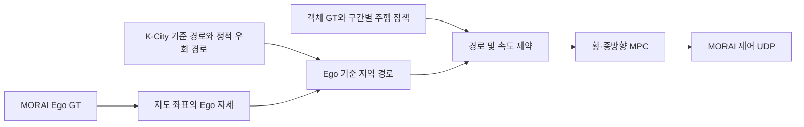

# Expert Recovery

`molit_e2e`의 Expert Recovery는 MORAI 시뮬레이터에서 K-City 기준 경로를 따라 주행하는 규칙 기반 교사다. 단독 모드에서는 출발부터 Ego를 운전해 주행 데이터를 수집한다. [DAgger 모드](../DAgger/README.md)에서는 모델이 운전하는 동안에도 현재 상태에 대한 교사 경로를 계산하고, 개입 시 그 경로를 공통 제어기에 전달한다.

## 주행 스택

1. **자세와 좌표계.** 대회용 UDP 브리지에서 Ego GT를 받아 제어용 odometry와 TF를 발행한다. 원본 K-City GT 헤딩은 ENU 기준으로 보존하고, 경로 추종에 쓰는 헤딩은 MGEO 로컬 UTM 지도 축으로 변환한다. 지역 경로는 Ego 기준인 `base_link`에서 전방 X, 좌측 Y로 표현한다.
2. **경로 구성.** 전역 기준 경로 또는 정적 장애물 우회를 반영한 경로에서 Ego 주변 구간을 잘라 지역 경로를 만든다. 정적 장애물은 GT 경계 상자와 도로 영역을 사용해 차량이 통과할 수 있는 우회 경로를 준비한다. 고속도로 정책은 합류·차선 변경에 사용할 경로를 낼 수 있다. 경로와 제약에 버전 및 epoch를 붙여 이전 경로의 제약이 새 경로에 섞이지 않도록 한다.
3. **주행 정책.** 구역별 속도 상한과 곡률에 따른 속도 계획 위에 동적·터널 장애물 제약, 로터리 양보, 고속도로 ACC, 신호 정지 제약을 적용한다. 활성 정책은 실행 프로필로 결정한다. 예를 들어 원본 시나리오 3랩 수집은 신호 제약을 켰고, 후속 all-green 랜덤 수집은 신호 제약을 끈 상태에서 주행용 신호등의 녹색 상태를 별도로 확인했다.
4. **차량 제어.** `precision_mpc_control`이 실제 속도와 조향 피드백을 사용해 조향·가감속을 계산한다. 단독 모드에서는 대회용 제어 UDP 브리지가 명령을 송신한다. DAgger에서는 교사 launch의 차량 출력이 비활성화되고, 선택된 교사 경로를 모델 경로와 같은 MPC 및 송신 경로에서 처리한다.

## 경로로 돌아오는 방식

MPC는 횡오차와 헤딩 오차를 사용해 복구 감속의 강도를 연속적으로 계산한다. 오차가 커지면 목표 속도가 복구 속도 설정값인 14.4 km/h 쪽으로 낮아진다. 저속에서는 MPC 비용 함수에서 횡오차의 가중치를 높인다. 경로의 목표 속도가 복구 속도보다 낮으면 그 값을 유지하므로 정지 제약도 보존된다. 차량은 현재 자세에서 조향과 가감속으로 경로를 다시 추종한다.

경로·차량 상태·활성 정책이 유효하고 충분히 최신인지 확인한 뒤 제어한다. 준비되지 않은 정책이나 만료된 입력, 최적화 실패는 정상 주행 명령 생성을 막고 브레이크 fallback으로 이어진다. DAgger에서 모델과 교사 사이를 전환하는 조건은 [DAgger 구현 문서](../DAgger/README.md)에 있다.

## GT 수집과 검증

- **원본 수집.** 공유 로거 모드에서는 한 곳에서 Ego/Object 상태를 조회하고 교사와 검증기에 동일한 데이터를 전달한다. Actor GT는 50 Hz로 조회하고, 원본 저장은 실행 프로필에 따라 20 Hz 또는 10 Hz로 선택했다. 조회 주기와 저장 주기를 별도로 기록한다.
- **출발과 종료.** 수집 실행기는 최신 GT, 유효한 지역 경로 및 MPC 결과, 단일 제어 출력, 준비된 우회 경로를 확인한 후 차량 출력을 켠다. 완료 여부는 실제 Ego 이동 거리와 코스 진행, 기록 종료 및 무결성, 생성 객체 정리 결과로 판단한다.
- **유효성 범위.** 완주, 원본 무결성, 객체 반응, 센서 프레임 동기화, 학습 데이터 승인은 각각 별도 검증 항목이다. 실패 기록은 원인을 확인할 수 있게 보존한다.

| `molit_e2e` 관측 | 확인한 결과 |
|---|---|
| 2026-09-13 최소 경로 추종 | 1랩 2,182.24 m를 161.34초에 완주했다. MPC 횡오차 RMS는 3.22 cm였다. |
| 2026-10-09 헤딩 변환 적용 | 원본 시나리오에서 약 2.18 km씩 3랩을 완주했고 원본 GT 무결성 검사를 통과했다. 정밀 지도 판정은 세 랩 모두 `REVIEW`였고 센서 영상은 수집하지 않았다. |
| 2026-10-20 물리 NPC 랜덤 시나리오 | GT 20랩이 기능·원본 무결성 검사와 MGEO 변환 검사를 통과했다. 실패 시도 10건은 별도 보존했다. 이 배치의 센서 동기화와 학습 적합성은 미검증이다. |

## 원본 추적 정보

아래 경로는 기존 `molit_e2e` 구성 저장소 기준이다.

| 확인 항목 | 원본 |
|---|---|
| ROS 구성과 실행기 | `expert-recovery` `4700a27`의 `src/global_path_planner/launch/expert_recovery.launch`, `tools/expert_recovery_run.py` |
| 추종 복구와 fallback | `expert-recovery`의 `src/control/src/precision_mpc_control.cpp` |
| 헤딩 변환과 3랩 확인 | `8f5afc5`(변환), `a8896d8`(검증 기록), `docs/status/gt-three-laps-heading-fixed-20261009.md` |
| 랜덤 시나리오와 배치 검증 | `docs/runbooks/generator-expert-gt.md`, `docs/status/WORKLOG.md`의 2026-10-20 배치 완료 항목 |

## EvoDriveFlywheel 적용 범위

MORAI의 GT와 지도는 교사의 경로 생성, 평가, 라벨 검증에 사용할 수 있다. Vision-only TFv6는 프로젝트에 정의된 카메라·Ego state·navigation 입력 계약을 따른다. 새 스택에 적용하려면 지도·차량 좌표계, 제어 단위, 정책별 동작, 복구 가능 범위, 지연을 대상 구성에서 검증해야 한다.
