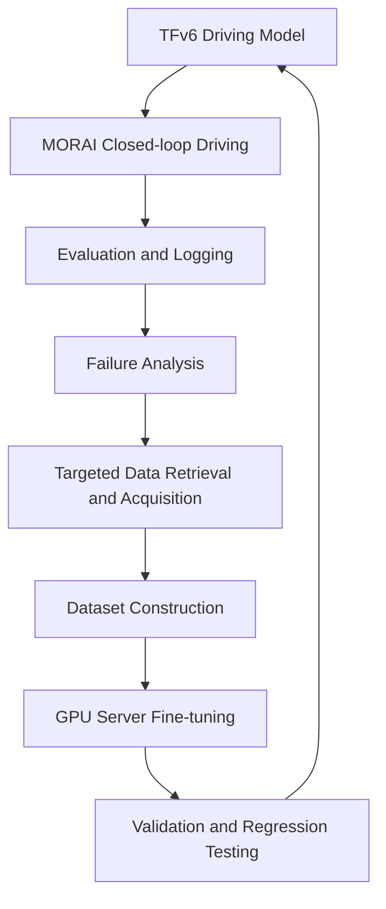

# EvoDriveFlywheel

**A Failure-driven Data Flywheel for Continuous Improvement of End-to-End Autonomous Driving**

## 프로젝트 목적
Camera-only E2E 주행 모델을 MORAI에서 실행하고, 주행 실패를 분석하여 관련 데이터를 검색·선별·추가 취득하고 재학습하는 순환형 연구 플랫폼을 구축한다. 반복 실험에서 확인되는 기술적 한계와 비효율을 연구 문제로 정의하고 개선 방법론을 검증한다. 장기 목표는 실시간 경량 VLA 및 자율주행 경진대회 참가, 학술 논문화이다. 구체적인 방법론과 novelty는 아직 확정하지 않았다.

## 확정된 기술 요구사항

| 항목 | 결정 |
|---|---|
| 초기 모델 | TransFuser v6, Vision-only ResNet34 |
| LEAD 기준 소스 | `main` 계열, v1.5.1 릴리스 |
| 데이터 프레임워크 | py123d / Apache Arrow |
| 인지 입력 | Camera-only (LiDAR/Radar 미사용); Ego state 및 navigation 활용 |
| 시뮬레이터 | MORAI 학교 전용 버전 |
| 시뮬레이션/취득 PC | Ubuntu 20.04.6 LTS, i7-13700 (16C/24T), RAM 약 32GB, RTX 4080 SUPER 16GB, NVIDIA driver 560.35.03 (`nvidia-smi` CUDA 12.6, 시스템 Toolkit 11.1/11.8, PyTorch Runtime 12.8) |
| 학습 서버 | RTX A5000 24GB × 3, 공개 체크포인트 기반 반복 fine-tuning |
| 실시간 요구 | MORAI 동시 실행 중 최신 센서 관측 기반 새 planning 결과 10Hz 이상, end-to-end latency 100ms 이내 목표 |
| 검증 | mean/p95/p99 latency, deadline miss rate, VRAM, 재학습 가능 여부 |
| 장기 모델 | Camera-only lightweight VLA; 초기 TFv6 자체는 VLA가 아님 |

Phase 2에서 공식 체크포인트의 카메라 rig, 좌표계와 입출력 계약을 확인했다. MORAI 이식과 10 Hz 폐루프, 학습 서버 실측은 후속 단계다. 내부 접속 주소 및 비공개 데이터는 공개 저장소에 기록하지 않는다. [TFv6 입력·출력 계약](docs/03_MODEL_INPUT_OUTPUT.md)

## Data Flywheel

시뮬레이션 PC는 MORAI 실행·데이터 취득·주행 평가 및 추론을 담당하는 것을 목표로 하며, 학습 서버는 데이터 처리 및 모델 업데이트를 담당한다. 상세 배치와 전송 방식은 미정이다. 모델/데이터/평가 이력과 실험 조건을 추적한다. 학습 풀, 개선 피드백 세트, 검증 세트 및 최종 테스트 세트를 분리한다. 모델 실패 궤적을 그대로 전문가 정답으로 사용하지 않으며 별도의 유효한 supervision을 확보한다.

## 기존 `molit_e2e` 구현 참고

- [Expert Recovery](Expert/README.md) — GT 기반 교사 주행, MPC 복구, 단독 데이터 수집 검증
- [DAgger](DAgger/README.md) — 모델과 교사 사이의 제어권 전환, 복구 라벨, 재학습 연결
- [Scenario Randomizer](Scenario_randomizer/README.md) — `OriginalVariantFixture`와 `v0.5.0`의 배치 방식 및 실제 MORAI 수집 결과

## Baseline resources

- [LEAD paper (CVPR 2026)](https://openaccess.thecvf.com/content/CVPR2026/html/Nguyen_LEAD_Minimizing_Learner-Expert_Asymmetry_in_End-to-End_Driving_CVPR_2026_paper.html)
- [Official upstream](https://github.com/kesai-labs/lead)
- [cvpr2026 Vision-only checkpoint](https://huggingface.co/ln2697/tfv6/tree/main/visiononly_resnet34) — reported Bench2Drive DS 91.60
- [main-compatible v1.5.1 Vision-only checkpoint](https://huggingface.co/ln2697/transfuser-carla-123d/tree/main/visiononly_resnet34_v1.5.1) — reported DS 87.6 ± 1.2
- [LEAD branch analysis](LEAD_BRANCH_COMPARISON.md)
- [TFv6 개발 환경](TFv6/README.md) — 고정 LEAD 소스, 전용 Python 환경 및 시뮬레이션 PC 검증 기록

EvoDriveFlywheel의 초기 재현 기준은 LEAD `main` v1.5.1의 Vision-only ResNet34 **seed 0**, planning 후속 학습 `model_0030.pth`다. [Phase 2 기술 문서](docs/README.md) · [공식 체크포인트와 검증 재현 명령](docs/07_INFERENCE_VERIFICATION.md)

## 단계별 개발 계획

1. Baseline 소스 분석 및 모델 로딩/독립 추론 검증
2. MORAI 센서·navigation·차량 제어 연동 및 10Hz 검증
3. 전문가 데이터 취득 및 학습 데이터 구성, A5000 3장 fine-tuning 검증
4. Closed-loop 평가 및 실패 사례 기록·분석
5. 실패 기반 데이터 검색·취득·재학습·재평가 연결
6. 파이프라인 병목 분석, 연구 질문 정의 및 통제 비교 실험
7. 반복 모델 개선, 경량 VLA 확장, 논문화 및 경진대회 검증

ScaleDrive, BridgeDrive, DRIFT, SimLingo는 후속 연구 참고 후보이며 도입 확정 사항이 아니다.

## 협업 및 운영 원칙

- 연구자와 ChatGPT가 연구 방향 및 설계를 논의하고 문서화한다. Codex는 승인된 설계를 조회하여 구현 및 실험을 수행한다.
- 초기 폴더 구조를 미리 확정하지 않고 필요한 파일만 점진적으로 추가한다.
- 특정 모델·시뮬레이터 의존성을 최소화하되 과도한 사전 설계를 피한다.
- 데이터/모델/실험 설정/평가 결과를 버전 관리한다. 대용량 원본 데이터 및 체크포인트는 Git 외부 저장소에 보관한다.
- 미검증 성능, 재현성, 학술적 기여를 단정하지 않는다. 대회 규정과 라이선스는 별도 검증한다.

## Research references

- [Data-Centric Evolution in Autonomous Driving](https://arxiv.org/abs/2401.12888)
- [A Survey on End-to-End Autonomous Driving Training](https://arxiv.org/abs/2610.00926)
- [SERA](https://arxiv.org/abs/2505.22067)
- [AutoScale](https://arxiv.org/abs/2605.21372)
- [RoaD](https://arxiv.org/abs/2512.01993)
- [SimLingo](https://github.com/RenzKa/simlingo)
- [DRIFT](https://arxiv.org/abs/2611.24719)
- [BridgeDrive](https://github.com/ShuLiu-ETHZ/BridgeDrive)
- [ScaleDrive](https://arxiv.org/abs/2611.02853)

## Current status

**Phase 2 완료.** 64,044,368개 파라미터의 공식 seed 0 모델이 엄격한 가중치 로딩 및 공개 CARLA 연속 세 관측 추론을 통과했다. RTX 4080 SUPER에서 공식 BF16 설정의 p99는 모델 단독 14.36 ms, 20개 관측의 offline pipeline 23.31 ms였다. 다음은 MORAI 카메라·navigation·제어 연동 및 전체 10 Hz 측정이다. [환경과 검증 명령](TFv6/README.md) · [벤치마크](docs/08_INFERENCE_BENCHMARK.md) · [MORAI 연동 요구사항](docs/09_MORAI_INTEGRATION_REQUIREMENTS.md)
