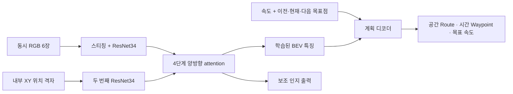

# 01 · TFv6 개요

**TFv6는 현재 장면과 목적지 방향을 보고, Ego가 따라갈 길·시간별 위치·목표 속도를 예측하는 모방학습 정책이다.** 한 교차로에서 영상이 같아도 직진과 좌회전의 정답은 다르므로, 영상과 함께 navigation 정보를 받는다. Ego 속도는 같은 길을 어떤 시간 계획으로 따라갈지 판단하는 데 쓰인다.

LEAD는 전문가 수집, 데이터 표현, 학습, 모델과 평가기를 포함한 연구 프레임워크다. TransFuser v6는 그 안에서 선택하는 정책이다. LEAD 논문의 연구 질문은 풍부한 GT를 가진 교사와 센서 기반 학습자 사이의 비대칭이다. 교사가 가려진 배우의 움직임을 확실히 알아도 카메라 학습자에는 정보가 부족할 수 있으며, 목적지를 한 점으로만 주면 주행 의도가 불명확해진다. 논문의 실험 계열과 이 문서의 main v1.5.1 체크포인트는 구분한다. [LEAD 논문](https://arxiv.org/abs/2512.20563) · [공식 저장소 README](https://github.com/kesai-labs/lead/blob/3764f79698922896638638df8062f2e064034610/README.md)

## Vision-only의 실제 구성

일반 TransFuser는 RGB 특징과 LiDAR raster 특징을 교환한다. 이 변형은 두 공간을 유지하면서 RGB와 **내부에서 생성한 위치 격자**로 학습된 BEV 특징을 형성한다. 위치 격자에는 실제 장면의 거리나 객체가 없다. 예를 들어 모델이 Ego 앞쪽 영역에 다른 위치보다 중요한 신호를 모으도록 할 수 있지만, 그 의미는 패턴과 지도 학습 정답에서 학습된다. Depth·BEV·박스 지도 학습은 이러한 표현을 형성하는 데 사용된다. [Backbone.forward, fuse_features](https://github.com/kesai-labs/lead/blob/3764f79698922896638638df8062f2e064034610/src/lead/policy/transfuser/network/transfuser_backbone.py#L215) · [Transfuser.forward](https://github.com/kesai-labs/lead/blob/3764f79698922896638638df8062f2e064034610/src/lead/policy/transfuser/transfuser.py#L110)

## 체크포인트 선택

| 항목 | 값 |
|---|---|
| 고정 LEAD | `3764f79698922896638638df8062f2e064034610`, 릴리스 `v.1.5.1` |
| 모델 | `ln2697/transfuser-carla-123d`, `visiononly_resnet34_v1.5.1/seed0` |
| Hugging Face 리비전 | `0a7a540df6a9dff6e0f3a64eb03222216b3f430c` |
| 단계 | 인지 사전학습으로 초기화한 계획 후속학습, `model_0030.pth` |
| 선택 이유 | 공개된 첫 seed를 재현 기준으로 고정 |
| 사용 조건 | 공식 모델 및 데이터 카드 모두 MIT 표시. 출처 및 revision 기록 |

고정 공개 저장소에는 `resnet34_v1.5.0`, `visiononly_resnet34_pretrain_v1.5.1`의 seed 0, `visiononly_resnet34_v1.5.1`의 seed 0/1/2가 있다. 사전학습 가중치는 인지 초기화용이다. 선택한 후속학습 seed 0은 동일 폴더에 config와 model 파일을 제공한다. 선택한 카드의 Bench2Drive DS는 seed 0/1/2에 각각 **86.2 / 88.6 / 88.0**으로 보고되었다. 파일 무결성과 이번 실측 범위는 [독립 추론 검증](07_INFERENCE_VERIFICATION.md)을 참고한다. [고정 Vision-only 모델 카드](https://huggingface.co/ln2697/transfuser-carla-123d/blob/0a7a540df6a9dff6e0f3a64eb03222216b3f430c/visiononly_resnet34_v1.5.1/README.md) · [전체 공개 모델 목록](https://huggingface.co/ln2697/transfuser-carla-123d/tree/0a7a540df6a9dff6e0f3a64eb03222216b3f430c) · [모델 파일 목록](https://huggingface.co/ln2697/transfuser-carla-123d/tree/0a7a540df6a9dff6e0f3a64eb03222216b3f430c)
