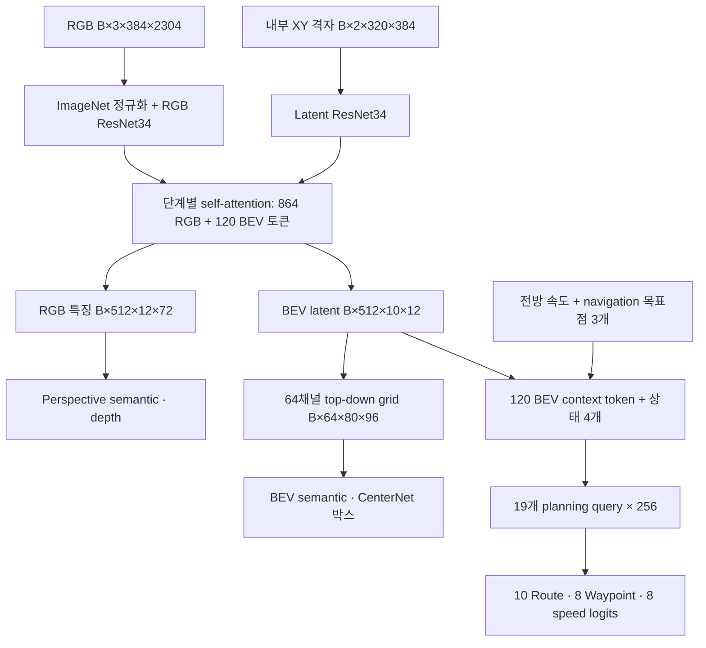

# 02 · Vision-only ResNet34 아키텍처

**설정·실행 비교.** 소스 기본값은 카메라 3장, `LTF=false`, planning decoder 꺼짐이다. seed 0 YAML은 6장, `LTF=true`, planning·semantic·depth·BEV semantic·box 모두 켜짐, radar 꺼짐을 지정한다. 이미지 anchor 수는 H/W를 32로 나눈 12×72, BEV 입력은 4 px/m와 x=[-32,64], y=[-40,40] 범위의 320×384, 예측 waypoint 수는 4 Hz × 2초로 8개다. 저장된 파생값과 실제 hook shape가 일치한다. `lidar_architecture=resnet34`는 내부 latent encoder 이름이다. `past_lidar_tick_ages`와 `merge_radar_into_lidar`는 YAML에 남아 있으며 이 실행의 실제 batch에는 두 센서 모두 없고, radar head도 생성하지 않는다. [카메라 기본값과 파생값](https://github.com/kesai-labs/lead/blob/3764f79698922896638638df8062f2e064034610/src/lead/config/policy/transfuser/camera_config.py#L10) · [LTF 기본값](https://github.com/kesai-labs/lead/blob/3764f79698922896638638df8062f2e064034610/src/lead/config/policy/transfuser/backbone_config.py#L18) · [Planning 기본값](https://github.com/kesai-labs/lead/blob/3764f79698922896638638df8062f2e064034610/src/lead/config/policy/transfuser/planning_config.py#L10)

## RGB와 latent encoder

ResNet34는 주변 픽셀의 정보를 convolution으로 모으고, residual block으로 깊은 네트워크에서도 앞 단계의 특징을 이어 보낸다. 처음 7×7 stride 2 convolution과 max-pool을 지나고, 네 단계의 BasicBlock은 각각 3, 4, 6, 3개다. 예를 들어 앞유리 영상의 차선 경계 같은 작은 패턴은 초반에 촘촘하고, 어느 방향을 향하는 도로인지 나타내는 조합은 더 작은 해상도의 많은 채널에 담길 수 있다. 6장 스티치를 하나의 이미지로 처리하기 때문에 각 카메라별 독립 네트워크 6개가 실행되는 구조가 아니다.

| 단계 | RGB encoder 출력 B=1 | Latent encoder 출력 B=1 | 채널 폭 / 공간 축소 |
|---|---|---|---|
| layer1 | 1×64×96×576 | 1×64×80×96 | 64 / 4× |
| layer2 | 1×128×48×288 | 1×128×40×48 | 128 / 8× |
| layer3 | 1×256×24×144 | 1×256×20×24 | 256 / 16× |
| layer4 | 1×512×12×72 | 1×512×10×12 | 512 / 32× |

RGB와 latent encoder 모두 ResNet34다. 후자의 입력 두 채널은 `linspace(0,1)`에서 만든 행·열 위치이고 장면에 따라 바뀌는 관측은 RGB뿐이다. 네트워크가 영상으로부터 얻은 정보를 위치 격자에 흘려 보내면, ego 주변 공간에 정렬된 과제를 풀도록 지도할 수 있다. 각 encoder stage의 hook 출력은 공식 경로에서 BF16이었다. [두 encoder 생성](https://github.com/kesai-labs/lead/blob/3764f79698922896638638df8062f2e064034610/src/lead/policy/transfuser/network/transfuser_backbone.py#L68) · [격자와 stage 실행](https://github.com/kesai-labs/lead/blob/3764f79698922896638638df8062f2e064034610/src/lead/policy/transfuser/network/transfuser_backbone.py#L215)

## 네 단계의 fusion

각 단계는 RGB 12×72와 BEV 10×12로 pooling하고 양쪽 채널 폭을 맞춘다. 두 격자를 펼친 984개 토큰에 학습된 위치 임베딩을 더한 뒤 2개 self-attention block을 적용한다. 각 block은 4개 head, 채널 C에 대한 FFN 폭 4C와 잔차 연결을 사용한다. 한 토큰의 query가 다른 토큰의 key와 얼마나 관련되는지 점수 `QKᵀ/√d`로 계산하고, softmax 가중치로 value를 합친다. 예를 들어 BEV 앞부분의 토큰이 이미지의 여러 위치를 함께 참고할 수 있다. 코드에서는 RGB와 BEV 부분을 다시 나눠 원래 해상도로 보간하고 각 encoder 특징에 더한다. 토큰 크기를 고정해 한 단계의 attention은 RGB 원본 픽셀 수 전체를 상대로 하지 않는다. Fusion 결과 hook의 두 격자는 float32이고 최종 backbone 반환값은 BEV BF16, RGB float32였다. [Fusion과 GPT](https://github.com/kesai-labs/lead/blob/3764f79698922896638638df8062f2e064034610/src/lead/policy/transfuser/network/transfuser_backbone.py#L342) · [SelfAttention](https://github.com/kesai-labs/lead/blob/3764f79698922896638638df8062f2e064034610/src/lead/policy/transfuser/network/transfuser_backbone.py#L552)

## 계획 디코더

`PlanningContextEncoder`가 BEV를 1×1 convolution으로 512→256 채널로 바꾸고 공간 sine 위치 특성을 더한다. 펼친 120개 BEV 토큰에 속도 1개·목표점 3개를 붙이면 실측 `(1,124,256)`이다. 목표점 3개는 동일 Linear로 변환하되 슬롯 위치가 다르다. 학습된 query 19개는 Route 10, Waypoint 8, Speed 1에 대응한다. 6개 decoder layer, cross-attention 8 heads를 거치며 query가 context 중 관련 정보를 취한다. 2D 증분을 누적해 Route와 Waypoint를, Speed query에서 8개 로짓을 만든다. Route와 Waypoint head가 같은 backbone과 decoder를 공유하므로 두 궤적은 관련 있지만 샘플링 목적이 다르다. [Query와 출력](https://github.com/kesai-labs/lead/blob/3764f79698922896638638df8062f2e064034610/src/lead/policy/transfuser/network/planning_decoder.py#L63) · [Context 구성](https://github.com/kesai-labs/lead/blob/3764f79698922896638638df8062f2e064034610/src/lead/policy/transfuser/network/planning_decoder.py#L385)

## 인지 head와 파라미터

Perspective semantic과 depth는 RGB 특징을 convolution/보간해 원본 크기로 올린다. BEV semantic과 CenterNet은 BEV 특징의 64채널 top-down grid를 사용한다. 박스 head에는 중심, 크기, offset, yaw class·residual, velocity 출력이 있다. `LTF`에서 velocity loss 가중치는 0이어서 이 출력의 속도 supervision은 꺼져 있다. 이 네트워크의 planning decoder는 공통 backbone과 Ego/navigation 토큰을 먼저 사용하며, 인지 head가 계산한 로짓을 조회하지 않는다. 인지 head를 생략할 때 얻는 속도나 모델 출력 동등성은 별도 검증 사항이다. 현재 benchmark는 가중치에 포함된 head 전부를 실행했다. [Forward 호출 순서](https://github.com/kesai-labs/lead/blob/3764f79698922896638638df8062f2e064034610/src/lead/policy/transfuser/transfuser.py#L110) · [Top-down](https://github.com/kesai-labs/lead/blob/3764f79698922896638638df8062f2e064034610/src/lead/policy/transfuser/network/transfuser_backbone.py#L196) · [가중치 정책](https://github.com/kesai-labs/lead/blob/3764f79698922896638638df8062f2e064034610/src/lead/config/policy/transfuser/transfuser_config.py#L55)

| 그룹 | 파라미터 | requires_grad | 비율 |
|---|---:|---:|---:|
| RGB ResNet34 | 21,284,672 | 21,284,672 | 33.23% |
| Latent ResNet34 | 21,281,536 | 21,281,536 | 33.23% |
| Fusion·top-down 등 기타 backbone | 10,132,288 | 10,132,288 | 15.82% |
| Planning decoder | 9,680,396 | 9,680,396 | 15.12% |
| Perspective semantic | 703,594 | 703,594 | 1.10% |
| Depth | 700,993 | 700,993 | 1.09% |
| BEV semantic | 37,696 | 37,696 | 0.06% |
| CenterNet | 223,193 | 223,193 | 0.35% |
| **합계** | **64,044,368** | **64,044,368** | **100%** |

이 표는 `named_parameters()`로 겹치지 않게 집계한 실측이다. `requires_grad`는 파라미터 속성이며 이 단계에서는 eval 및 gradient 비활성화로 실행했다. 체크포인트는 256,565,012 bytes이며 state key 771개에 파라미터 외 저장 buffer도 포함된다. 모듈별 FLOP와 개별 실행시간은 측정하지 않았다.
