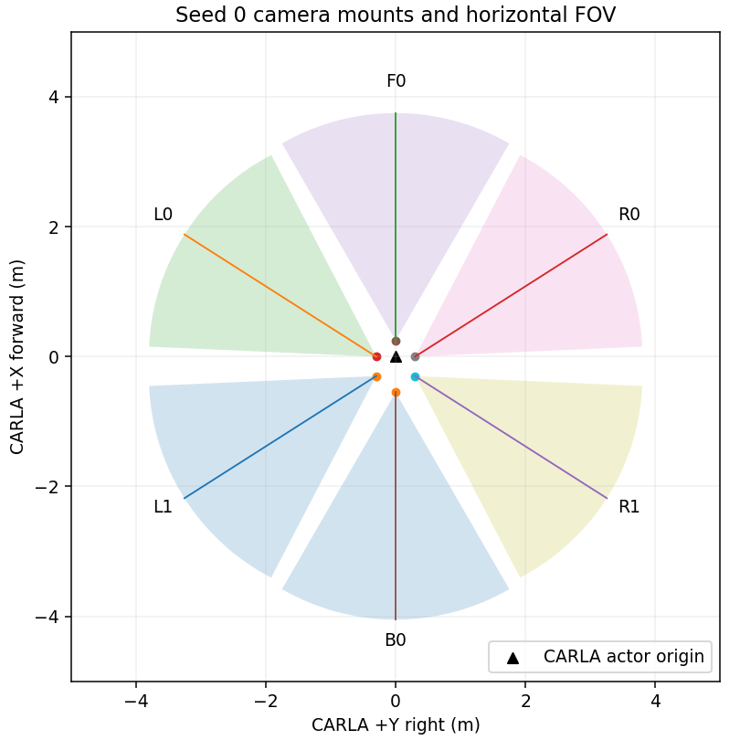
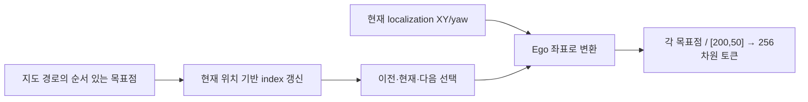

# 03 · 모델 입력·출력 계약

## 카메라 rig와 이미지

카메라 위치는 체크포인트의 **CARLA actor 원점**에 대한 m, yaw는 CARLA +X 전방/+Y 우측/+Z 상방의 도 단위다. 카메라 6개의 roll과 pitch는 모두 0이다. 원본과 개별 모델 입력은 384×384 RGB, 수평 FOV 60°다. 정사각형이고 fx=fy이므로 수직 FOV도 60°다. 일반 화면 비율에서는 `vFOV=2 atan(H/(2 fy))`로 구한다.

| 스티치 순번 | Camera ID (enum) | 장착 (X,Y,Z) m | yaw |
|---:|---|---|---:|
| 1 | PCAM_L1 (3) | (-0.30,-0.30,2.25) | -122.5° |
| 2 | PCAM_L0 (2) | (0,-0.30,2.25) | -57.5° |
| 3 | PCAM_F0 (0) | (0.25,0,2.25) | 0° |
| 4 | PCAM_R0 (5) | (0,0.30,2.25) | +57.5° |
| 5 | PCAM_R1 (6) | (-0.30,0.30,2.25) | +122.5° |
| 6 | PCAM_B0 (1) | (-0.55,0,2.25) | 180° |

광학 좌표는 OpenCV의 +X 오른쪽, +Y 아래, +Z 앞이다. 고정 샘플에서 확인한 `K`의 행은 `[332.553755,0,192]`, `[0,332.553755,192]`, `[0,0,1]`이다. `fx=fy=384/(2tan(30°))`, `cx=cy=192`; 로그는 distortion=None이다. Extrinsic은 저장된 `camera_to_imu_se3`의 `[tx,ty,tz,qw,qx,qy,qz]`에서 quaternion을 회전행렬로 변환해 `p_imu=R p_cam+t`로 적용한다. 원본 장착값을 CARLA ego에서 ISO로 바꿀 때 Y 반전, floor-center→rear-axle 이동, 광학 축 회전을 포함한다. 아래 값은 로그 metadata의 반올림값이다. [ID 매핑](https://github.com/kesai-labs/lead/blob/3764f79698922896638638df8062f2e064034610/src/lead/api/py123d_log_api.py#L24) · [보정 행렬 산출](https://github.com/kesai-labs/lead/blob/3764f79698922896638638df8062f2e064034610/src/lead/common/carla_to_123d.py#L196)

| Camera | camera→IMU 이동 XYZ (m) | 회전 quaternion WXYZ |
|---|---|---|
| PCAM_L1 | (1.34855, 0.30000, 1.89065) | (0.678858, -0.678858, -0.197869, 0.197869) |
| PCAM_L0 | (1.64855, 0.30000, 1.89065) | (0.678858, -0.678858, 0.197869, -0.197869) |
| PCAM_F0 | (1.89855, 0.00000, 1.89065) | (-0.500000, 0.500000, -0.500000, 0.500000) |
| PCAM_R0 | (1.64855, -0.30000, 1.89065) | (-0.197869, 0.197869, -0.678858, 0.678858) |
| PCAM_R1 | (1.34855, -0.30000, 1.89065) | (0.197869, -0.197869, -0.678858, 0.678858) |
| PCAM_B0 | (1.09855, 0.00000, 1.89065) | (0.500000, -0.500000, -0.500000, 0.500000) |

이 경로에서 crop/resize/기하학적 파노라마 보정은 수행하지 않는다. 검증 입력 `rgb`는 픽셀 스케일 0–255의 `float32`이고, backbone에서 `((x/255)-mean)/std`를 적용한다. 채널별 mean=(0.485,0.456,0.406), std=(0.229,0.224,0.225)이다. CARLA live 경로의 BGRA→RGB/선택 JPEG 재인코딩과 Arrow의 RGB JPEG 디코딩은 서로 다른 입력 경로다. [Feature Builder](https://github.com/kesai-labs/lead/blob/3764f79698922896638638df8062f2e064034610/src/lead/policy/transfuser/dataloader/features.py#L23) · [정규화](https://github.com/kesai-labs/lead/blob/3764f79698922896638638df8062f2e064034610/src/lead/policy/transfuser/utils/ops.py#L52) · [CARLA 입력](https://github.com/kesai-labs/lead/blob/3764f79698922896638638df8062f2e064034610/src/lead/api/abstract_driving_agent.py#L307)

## 직접 입력과 주변 데이터

| 키 또는 데이터 | Source | Shape, dtype | 단위·좌표 | 사용처 |
|---|---|---|---|---|
| `rgb` | 동기화된 6개 카메라 | (B,3,384,2304), float32 batch | RGB, 0–255 | 필수, backbone |
| `speed` | 속도를 Ego 전방 단위축에 투영 | (B,), float32 | m/s, 부호 포함 | 필수, 계획 상태 토큰. `/25` |
| `previous_target_point`, `target_point`, `next_target_point` | global route의 연속 세 목표점 | 각각 (B,2), float32 | m, +X 전방/+Y 우측 | 필수, 공유 Linear와 토큰 위치로 순서 식별. 각 `/[200,50]` |
| `town` | log metadata 또는 online location | B개 문자열 | 식별자 | Feature Builder/Batch 계약. 이 forward의 neural 입력에는 읽히지 않음 |
| 현재 위치·헤딩 | localization 및 Ego pose | XY와 yaw | 지도 좌표 → Ego | navigation 변환 및 정답의 anchor |
| acceleration, yaw rate, steer | Ego 동역학 및 조작 상태 | 해당 없음 | m/s², rad/s 등 | 해당 forward 직접 입력 없음. 기록·평가·제어에서 별도 사용 가능 |
| 과거 ego 위치·yaw, 과거 RGB | SceneData의 선택 필드 | seed 0 RGB age 0 | 현재 anchor | 이 seed의 직접 입력에는 히스토리 없음 |
| 주변 GT, 지도, 미래 ego, raw depth/semantic | 학습·평가 데이터 | 이 forward에 없음 | modality별 | 정답 생성과 분석 |

공식 offline feature를 생성한 후 `driving_meta`, box, 신호를 제거한 SceneData에서도 feature가 일치했다. Offline SceneLoader가 navigation을 준비할 때 이미 저장된 **localized pose와 route 인덱스**를 읽는다. 실제 live agent는 별도의 현재 localization과 route로 같은 의미의 목표점을 구성한다. [Speed projection](https://github.com/kesai-labs/lead/blob/3764f79698922896638638df8062f2e064034610/src/lead/log_reader/carla_decoding.py#L14) · [Batch 구성](https://github.com/kesai-labs/lead/blob/3764f79698922896638638df8062f2e064034610/src/lead/policy/transfuser/transfuser.py#L264)

## Navigation과 좌표 변환

Offline에서는 `target_point_indices["3.25"]`와 custom metadata의 목표점 배열을 사용한다. 공식 live controller 기본 pop 반경은 **5 m**이며, 현재 위치에서 최대 진행 거리 **50 m** 범위 안의 후보를 탐색하고 조밀한 경우 **4 m**로 재계획한다. 현재 위치에서 50 m를 넘는 next는 현재 target으로 대체한다. 경로 추적 중에는 제한 거리 안의 후보를 보고 pop 반경 내에서 Ego와 가장 멀리 떨어진 후보까지 index를 진행한다. 좌회전/우회전은 따로 들어오는 command ID가 아니라 목표점의 기하로 드러난다. 예를 들어 (6,0) 주변을 계속 따라가는 직진, (6,-4)가 이어지는 좌회전, (6,4)가 이어지는 우회전처럼 조건을 제공한다. 이 숫자는 좌표 설명용이며 실제 출력은 [Walkthrough](10_END_TO_END_WALKTHROUGH.md)에 있다. 학습의 perturbated view에서는 같은 목표점을 rig의 횡이동과 yaw에 맞춰 함께 변환한다. 고정 경로의 feature builder에서 독립적인 target point 난수 가산은 확인되지 않았다. [Offline 목표점](https://github.com/kesai-labs/lead/blob/3764f79698922896638638df8062f2e064034610/src/lead/log_reader/scene_loader.py#L425) · [Live 목표점](https://github.com/kesai-labs/lead/blob/3764f79698922896638638df8062f2e064034610/src/lead/api/abstract_driving_agent.py#L413) · [RoutePlanner 갱신](https://github.com/kesai-labs/lead/blob/3764f79698922896638638df8062f2e064034610/src/lead/common/planning/route_planner.py#L110)

평면 좌표에서 `p_ego=R(-yaw)(p_world-t)`, `p_world=t+R(yaw)p_ego`를 사용한다. 예를 들어 CARLA 지도에서 Ego=(10,20), yaw=+90°, world=(10,26)이면 ego=(6,0)이다. CARLA의 +X 전방/+Y 우측과 ISO 8855의 +X 전방/+Y 좌측은 Y와 같은 물리 회전의 yaw 부호가 다르다. py123d 원시 위치·센서 metadata는 ISO, 모델의 목표점·계획 출력은 CARLA ego view다. OpenCV 광학 축은 별도의 회전을 필요로 한다. 기존 [Expert Recovery](../Expert/README.md)는 MGEO map과 `base_link`(+Y 좌측)를 사용하며 MORAI 원본 헤딩은 ENU로 기록했다. 실제 MORAI export의 pose 원점, yaw·pitch·roll 순서, FOV 규약은 테스트로 판정할 항목으로 남긴다.

## 계획 및 인지 출력

| 텐서 | B=1 shape | 단위·좌표 | 의미/후처리 |
|---|---|---|---|
| `route` | (1,10,2) | m, CARLA Ego XY | 공간 샘플. 정답은 첫 점 약 2.5 m, 이후 1 m 간격의 정규화 경로이며 길이 약 11.5 m. 네트워크 결과의 간격과 유효성은 별도로 검사 |
| `future_waypoints` | (1,8,2) | m, CARLA Ego XY | +0.25초부터 +2초의 시점별 위치. `distance/0.25`로 구간 평균 속도 추정 가능 |
| `target_speed_distribution` | (1,8) | logits | `softmax(float32)` 후 bin 확률. 속도 bin은 0,4,8,10,13.888889,16,17.777778,20 m/s |
| `target_speed_scalar` | (1,) | m/s | 확률×bin의 합. 기본 공식 agent는 `P(bin 0)>0.9`이면 제어 목표를 0으로 함 |
| `semantic / depth` | (1,10,384,2304) / (1,384,2304) | 클래스 logits / m | perspective 분할은 argmax, depth는 회귀 |
| `bev_semantic` | (1,12,320,384) | 클래스 logits, BEV raster | top-down 분할 |
| `bounding_box` | (1,C,80,96) | BEV grid, yaw rad·velocity m/s | heatmap C=7, wh/offset C=2, yaw class C=12, yaw residual/velocity 각 C=1 |
| `radar_features`, `radar_predictions` | None | — | 비활성 |

박스 decoding은 sigmoid heatmap의 국소 최대와 상위 100개 후보를 뽑고, offset·크기·각도 잔차를 조합한다. Ego-frame 변환에 0.3 confidence 기준을 사용한다. Velocity는 객체 속도의 별도 출력이며 이 모델의 계획 속도와 구분된다. [CenterNet 후처리](https://github.com/kesai-labs/lead/blob/3764f79698922896638638df8062f2e064034610/src/lead/policy/transfuser/network/center_net_decoder.py#L298-L392)

공식 BF16 autocast의 각 출력 dtype과 실제 좌표는 [Walkthrough](10_END_TO_END_WALKTHROUGH.md)에 기록했다. Route와 Waypoint는 decoder의 XY 변위를 누적한 위치이며, 속도 logits은 정규화 전 값이다. 공식 기본 제어는 Route로 조향하고 Target Speed로 가감속한다. `PathSpeedTracker`의 PID 또는 `WaypointTracker`의 시간 궤적 기반 제어는 [연동 요구사항](09_MORAI_INTEGRATION_REQUIREMENTS.md)을 참고한다. [출력의 정의](https://github.com/kesai-labs/lead/blob/3764f79698922896638638df8062f2e064034610/src/lead/policy/transfuser/network/planning_decoder.py#L136) · [속도 후처리](https://github.com/kesai-labs/lead/blob/3764f79698922896638638df8062f2e064034610/src/lead/evaluation/agents/transfuser/transfuser_agent.py#L71)
