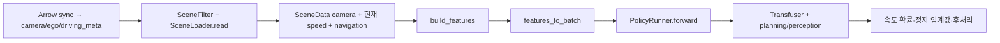
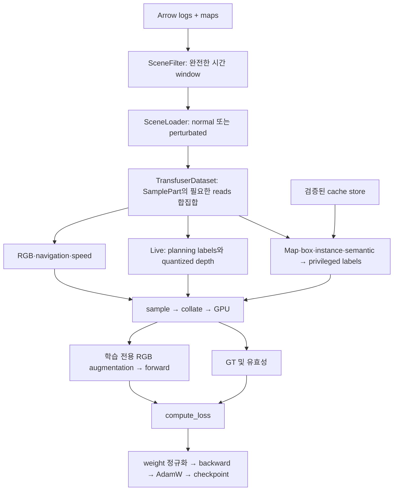

# 04 · 전체 데이터 흐름

## Inference



| 단계 | 실제 함수 | 입력 → 출력 | B=1 shape 및 dtype | 장치 |
|---|---|---|---|---|
| 관측 인덱싱 | `get_scenes`, `ArrowSceneAPI` | log sync row에서 view와 anchor 지정 | 20 Hz tick에서 4 Hz RGB anchor를 선택 | CPU |
| 프레임 읽기 | `SceneLoader.read`, `_read_camera_stream` | JPEG와 camera metadata, 현재 Ego, 목표점, provenance → SceneData | 각 RGB (384,384,3) uint8, 6장 | CPU |
| 관측 좌표 | `_target_points_in_view`, `carla_forward_speed` | 저장 route와 localized pose, velocity → 3×XY + speed | 3개의 (2,) m, 부호 있는 scalar m/s | CPU |
| Feature | `build_camera_features` | 카메라 이미지 연결 후 HWC→CHW | (3,384,2304) uint8 | CPU |
| Batch와 전송 | `Transfuser.features_to_batch` | numpy→float32 Tensor와 B축 추가 | RGB (1,3,384,2304), 3개 (1,2), speed (1,) | CUDA |
| 내부 전처리 | `TransfuserBackbone.forward`, `normalize_imagenet` | dtype/채널 메모리 형식 설정, RGB 정규화와 내부 격자 | RGB (1,3,384,2304), 격자 (1,2,320,384) | CUDA |
| Backbone | `forward_layer_block`, `fuse_features` | RGB와 latent 4단계 특징 교환 | RGB (1,512,12,72), BEV (1,512,10,12) | CUDA |
| 계획 | `PlanningContextEncoder`, `PlanningDecoder.forward` | context (1,124,256), query (1,19,256) → 위치와 속도 | Route (1,10,2), WP (1,8,2), logit (1,8), speed (1,) | CUDA |
| 인지 | `PerspectiveDecoder`, `BEVDecoder`, `CenterNetDecoder` | 공통 특징에서 각각 인지 결과 | [출력 계약](03_MODEL_INPUT_OUTPUT.md) | CUDA |
| 후처리 | `decode_two_hot`, agent의 `_post_process_target_speed` | logits→확률·기댓값, zero-bin brake threshold | tracked speed (1,), m/s | CUDA |
| 제어 연결 | 공식 CARLA 경로의 `PathSpeedTracker` 또는 `WaypointTracker` | 경로·속도를 steer/throttle/brake로 변환 | 3개 scalar | CPU, 소스 확인 |

B축은 배치 크기에 비례하고 나머지 C/H/W와 토큰 수는 고정 rig와 설정에서 일정하다. 검증 harness는 공식 `PolicyRunner`를 사용했고 컨트롤러나 시뮬레이터를 기동하지 않았다. Benchmark에서는 feature/batch CPU와 GPU 전송을 별도 계측했고, shape hook은 검증에만 달았다. Label을 제거한 뒤에도 batch가 동일했음을 확인했다. [SceneLoader.read](https://github.com/kesai-labs/lead/blob/3764f79698922896638638df8062f2e064034610/src/lead/log_reader/scene_loader.py#L167) · [Transfuser의 배치 구성](https://github.com/kesai-labs/lead/blob/3764f79698922896638638df8062f2e064034610/src/lead/policy/transfuser/transfuser.py#L259) · [PolicyRunner](https://github.com/kesai-labs/lead/blob/3764f79698922896638638df8062f2e064034610/src/lead/evaluation/inference/policy_runner.py#L18)

Feature Builder에서는 원래 영상 순서로 두 줄의 배열 연산을 한다. `axis=1`은 HWC에서 너비이고, `transpose`는 결합한 이미지의 채널을 앞으로 보낸다.

```python
stitched_camera_image = np.concatenate([camera.image for camera in scene_data.cameras], axis=1)
data["rgb"] = np.transpose(stitched_camera_image, (2, 0, 1))
```

[고정 Feature Builder](https://github.com/kesai-labs/lead/blob/3764f79698922896638638df8062f2e064034610/src/lead/policy/transfuser/dataloader/features.py#L35-L40)

## Training



- `AbstractPolicy.build_scene_filter`는 로그 선택뿐 아니라 미래 +40 tick의 window를 요청한다. `SceneLoader`는 py123d의 split/log filter로 RGB anchor와 인접 시각을 묶는다. `TransfuserDataset.get_sample_parts`에서 해당 head에 필요한 원본 스트림을 선언하고 `AbstractPolicyDataset._assemble`가 합쳐 한 번 읽는다. 카메라 view는 normal이거나 log가 제공하는 perturbated rig다. 저장된 선택 확률은 0.5다. 목표점·ego/GT는 같은 view로 옮긴다.
- RGB/현재 상태·시간 waypoint·공간 route 및 depth는 이 커밋의 구성에서 live builder가 만든다. Cache 대상은 대응하는 codec이 선언된 박스/BEV/semantic 등 privileged part다. 전체 coverage가 일치하지 않는 샘플은 원본으로 다시 조립할 수 있다. 저장된 seed 0 YAML의 cache 경로를 복사하지 않고 검증에서는 cache를 끈 상태로 공식 builder를 실행했다.
- `TransfuserTrainingSample.collate`는 동일한 shape의 field를 stack하고 적절한 dtype으로 변환하며 town 등 신원 값은 문자열/metadata로 유지한다. GPU `augment_batch`는 train 모드일 때만 RGB에 설정 확률 0.2를 사용한다. Label은 동일 batch에 보존되지만 forward는 필요한 키만 읽고, `compute_loss`가 예측과 정답을 비교한다. [SampleParts](https://github.com/kesai-labs/lead/blob/3764f79698922896638638df8062f2e064034610/src/lead/policy/transfuser/dataloader/dataset.py#L189) · [Dataset 조립](https://github.com/kesai-labs/lead/blob/3764f79698922896638638df8062f2e064034610/src/lead/api/abstract_dataset.py#L146) · [학습 step](https://github.com/kesai-labs/lead/blob/3764f79698922896638638df8062f2e064034610/src/lead/training/train.py#L516)

| 항목 | Training | Inference |
|---|---|---|
| 모델 입력 | 현재 RGB·ego/nav, 선택 시 perturbated view 및 RGB augmentation | 현재 RGB·ego/nav, eval; 이번 검증 normal view |
| 미래 Ego·주변 GT·지도 정답 | label builders 및 loss가 사용 | 모델 batch에 없음 |
| 인지/계획 head | 설정에 따라 실행 및 지도 | 이 체크포인트의 공식 forward에서 모두 실행 |
| Batch와 gradient | 전역 batch를 GPU rank별로 배치, backward | B=1 `torch.inference_mode()` |
| Loss | task별 loss와 가중치, optimizer 업데이트 | 일반 추론 무관. 검증에서 한 anchor의 eval loss만 계산 |
