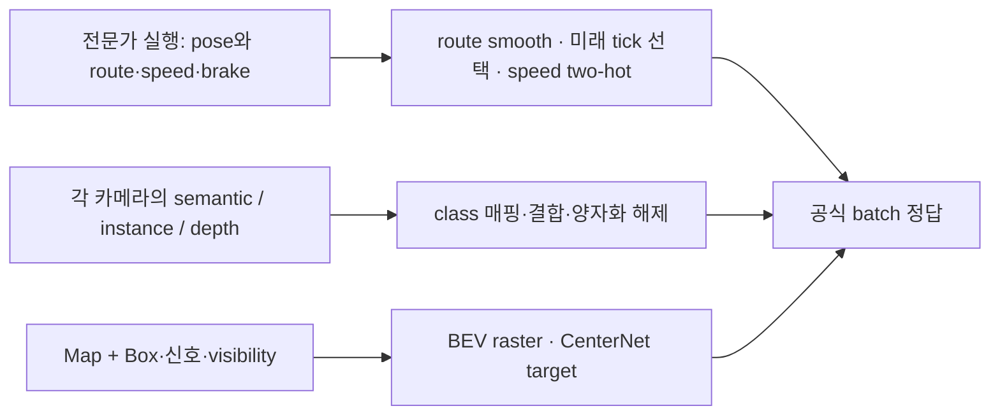

# 05 · 공식 로그와 학습 정답

## Arrow가 보관하는 것

**Log**는 경로 실행 한 번의 시간축이다. **Scene**은 그 log 중 특정 anchor와 history/future window를 보는 방법이다. **Modality**는 RGB·Ego 등 타입별 기록이고, **metadata**는 같은 스트림을 해석하는 카메라 보정/동역학/맵 등의 정보다. **Arrow IPC**는 타입 있는 컬럼 바이너리 파일 형식이다. `SceneFilter`는 split/log/time window를 제한하고, `SceneLoader`는 그 시점의 여러 스트림을 읽어 한 `SceneData`로 묶는다. `sync.arrow`의 `sync.timestamp_us`와 modality row 인덱스 덕에 저장률이 다른 센서들도 같은 관측의 anchor를 찾을 수 있다. **Cache**는 비용이 큰 label/feature를 미리 저장하며, **fingerprint**는 camera order, BEV geometry, label 관련 설정과 reconcile한다. 다른 설정에서 만든 cache의 동일 키를 그대로 재사용하면 geometry가 틀릴 수 있다. [공식 데이터 문서](https://github.com/kesai-labs/lead/blob/3764f79698922896638638df8062f2e064034610/docs/data_access.md) · [캐시 정책](https://github.com/kesai-labs/lead/blob/3764f79698922896638638df8062f2e064034610/docs/training.md) · [py123d 소스](https://github.com/kesai-labs/py123d/tree/4d20a6cfd50f7966647448084f6482c0b65effff)

공식 normal-view Town01 로그에서 **30 Arrow 스트림**, dataset `config.yaml`, `maps/carla/carla_town01.arrow`를 받아 총 30,383,784 bytes를 확인했다. RGB/depth/semantic/instance는 각 F0/L0/L1/R0/R1/B0 여섯 파일이다. 공개 로그의 `radar.radar_merged.arrow`와 odometry 기반 `route_position.arrow`는 이 검증의 reader/label에 필요하지 않아 받지 않았다. `route_position`의 실주행 polyline과 `driving_meta.route`의 관측 시점 expert 계획은 별개의 데이터다. 실제 Schema의 대표 열은 아래와 같으며 카메라 열의 prefix는 Camera ID와 modality에 따라 바뀐다.

| 실측 파일 | 실제 Arrow 필드와 타입 | 공개 저장률 | seed 0 사용 |
|---|---|---:|---|
| `sync.arrow` | UUID 확장형, timestamp_us int64, modality별 row int64 | 기본 20 Hz tick | 관측/정답 alignment |
| `camera.pcam_f0.arrow` 등 | timestamp_us int64, data binary, camera_to_global_se3 fixed list[7] double | 4 Hz | JPEG RGB 모델 입력. calibration은 schema metadata |
| `camera_depth/semantic/instance.pcam_*.arrow` | timestamp_us int64, data binary, camera_to_global_se3 fixed list[7] double | 4 Hz | 보조 정답. instance와 semantic을 함께 해석 |
| `ego_state_se3.arrow` | timestamp_us int64, imu_se3 double[7], dynamic_state_se3 double[9] | 20 Hz | 전방 속도 입력, pose 변환, 미래 Waypoint |
| `box_detections_se3.arrow` | timestamp_us int64, box list<double[10]>, track_token list<string>, label list<uint16>, velocity list<double[3]>, num_lidar_points list<int32> | 20 Hz | 인지 정답과 class/visibility 판정 |
| `traffic_light_detections.arrow` | timestamp_us int64, lane_id list<int32>, status list<uint8> | 20 Hz | loader의 현재 상태; box/metadata에 연결된 신호와 stop 표시는 보조 정답 |
| `custom.driving_meta.arrow` | timestamp_us int64, data binary; schema metadata의 route target point 목록 | 20 Hz | localized pose/target point indices, route, target_speed/brake, box attributes |
| `lidar.lidar_top.arrow` | timestamp_us/end_timestamp_us int64, data binary | 20 Hz | 이 모델 batch와 이번 label builder의 LiDAR sweep read는 없음. 원본 수집의 box point count에 영향 |
| `maps/carla/carla_town01.arrow` | object_id int64, map_layer int8, features binary, wkb binary 및 정적 map metadata | 타운당 1개 | BEV 지도 정답, 추론 batch 입력 없음 |

저장률 근거는 공식 config의 CARLA 20 fps와 카메라 저장 stride 5다. 모든 live 소스의 물리 타임스탬프 정합을 이 한 log에서 일반화할 수 없다. [고정 데이터 트리](https://huggingface.co/datasets/ln2697/lead-123d/tree/49565fcf35fd02b03c322a5ab560631b9c706a53/logs/normal_view/SignalizedJunctionLeftTurn/Town01_Rep0_route_002516_route0_08_02_07_01_23) · [공식 모달리티와 저장률](https://github.com/kesai-labs/lead/blob/3764f79698922896638638df8062f2e064034610/docs/data_access.md)

## 실제 정답 생성

| 정답 | 데이터에서 만들어지는 방식과 결측 처리 |
|---|---|
| Route | 현재 `driving_meta.route`의 앞 20개 세계 지점 → Ego XY로 변환 → smoothing의 2.5 m 시작 및 1 m 간격 → 10개. current expert path를 사용한다. 출력에 per-point 유효성 확률이 없으므로 smoothing은 필요할 때 마지막 segment의 방향으로 외삽한다. 수집에서는 분기·정지·경계와 유효 길이를 기록 |
| Waypoints | 미래 tick 5,10,…,40의 관측 Ego 위치를 현재 ego 원점/anchor localized yaw로 변환. `future_yaws`도 계산되나 이 planning 출력과 loss는 XY만 소비. 어느 tick이든 누락되면 builder가 오류를 내므로, 원본 filter/샘플 admission에서 완전한 시간 구간을 확보 |
| Target speed | 현재 전문가 `target_speed` m/s와 `brake`. Brake는 bin 0 one-hot, 나머지는 인접 bin으로 거리 비례 분배. Ego 실측 속도는 별도 입력 |
| Perspective semantic | 6장 raw semantic class와 instance ID, box attributes로 class를 매핑하고 이어서 384×2304 uint8 label |
| Depth | 각 카메라 양자화 code를 정렬·결합. 디바이스에서 unsigned dtype 최대값에 맞춰 `code × 50 m / max_code`를 적용하는 이 구성의 50 m 선형 정답. 샘플은 uint8. 다른 dataset의 depth 범위 metadata를 확인해야 함 |
| BEV semantic | 도로·lane 마킹, stop/sign 등 정적 지도 raster와 actor/신호의 동적 occupancy를 같은 ego view에 합성. (320,384), 12 클래스 |
| CenterNet | 차량/보행자/신호 등의 유효 box를 4 px/m BEV에 투영 후 downsample 4로 80×96 grid. 7종 중심 heatmap과 wh·offset·yaw·velocity 및 양성 픽셀 마스크. 속도 label은 생성되며 LTF에서 그 loss 가중치는 0 |

Box와 BEV의 기본 visibility 검사는 관측된 `num_points`와 `visible_pixels`가 **둘 다** 낮을 때 해당 조건을 적용한다. 저장된 vehicle 기준 3 LiDAR points와 5 pixels, pedestrian 기준 5 points와 15 pixels다. 음수나 누락은 해당 필터 조건을 바꿀 수 있다. `num_points`를 과거에 센서 포인트를 포함한 box recorder에서 산출했으므로, City 공통 GT만 복제하면 같은 visibility 분포라고 볼 수 없다. 원본을 대체할 때는 실제 화면 가시성·occlusion 기록, instance와 box의 ID 연결, 필터 의미를 따로 검증한다. [정답 조립과 미래 pose](https://github.com/kesai-labs/lead/blob/3764f79698922896638638df8062f2e064034610/src/lead/policy/transfuser/dataloader/dataset.py#L329) · [인지 정답과 visibility](https://github.com/kesai-labs/lead/blob/3764f79698922896638638df8062f2e064034610/src/lead/policy/transfuser/dataloader/label_builders.py#L65) · [박스 원본 기록](https://github.com/kesai-labs/lead/blob/3764f79698922896638638df8062f2e064034610/src/lead/expert/logs_writing/recorders/box_detections_recorder.py#L40)

## MORAI 수집 계약 초안

| Data item | 시간 요구와 포맷 | 좌표/학습 목적 | 필수 범위 |
|---|---|---|---|
| 6개 RGB와 metadata | 같은 anchor의 6장 RGB, 원본 센서 timestamp, K/extrinsics와 rig 버전. 공식 4 Hz 저장. 운영은 10 Hz 이상 fresh plan을 목표로 6뷰 공급률과 skew 예산을 실측 | OpenCV optical→ego; 전 모델 입력 | 필수 |
| Ego+localization | 공통 시계 위치·헤딩·전방 속도 및 interpolation provenance. 공식 20 Hz. 학습에는 +0.25초 배수 시각을 확정해야 함. MORAI 원본 pose는 20 Hz나 센서 cadence 이상의 공통 시계 기록을 검토 | MGEO/ENU 원본 및 검증된 ego 변환; navigation/waypoint | 필수 |
| Navigation/route | 현재 route ID·index·세 목표점, 현재 Expert route 및 시간/권한 ID | local CARLA 계약으로 변환; 입력과 spatial label 분리 | 필수 |
| 교사 속도 및 브레이크 | anchor마다 causal speed m/s, stop/hazard, 사유·유효성 기록 | speed class target, MPC 단위 별도 | planning 속도 loss 필수 |
| Future ego | 관측 이후 2초의 연속 교사 물리 주행 | Ego anchor (8,2); +0.25초 간격 | temporal loss 필수 |
| Depth/semantic/instance | 각 RGB와 같은 anchor·rig, metric encoding과 class·actor ID | depth, segmentation, visibility | 해당 보조 head 학습에 필요 |
| Map·Object·Signal GT | topology, 도로/차선/정지/신호, 3D box와 velocity·actor ID·가시성 | ISO/world 원본과 변환 계약; BEV/CenterNet | 해당 보조 head 학습에 필요 |

향후 수집에서는 Phase 3의 운영률과 label 판정에 맞춰 위 시간 계약을 실측으로 확정한다. 기존 DAgger의 실제 궤적과 공간 교사 제안을 변환할 때 필요한 항목은 [MORAI 연동 요구사항](09_MORAI_INTEGRATION_REQUIREMENTS.md)에 이어진다.
