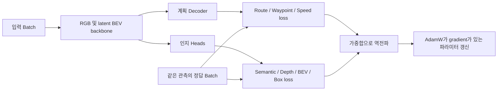

# 06 · TFv6가 정답으로부터 학습하는 방법

## 사전 학습과 후속 학습

공식 스크립트는 인지 과제로 먼저 카메라와 latent BEV의 특징을 학습한 뒤 Planning Decoder를 켜고 후속 학습한다. 초기 인지 단계에서 영상의 도로·객체, 주변 공간, 거리 같은 감독 신호로 backbone을 훈련한다. 후속 단계에서는 동일한 특징으로 주행 계획을 학습하면서 인지 감독도 유지한다. seed 0의 저장 YAML은 `initial_weights_file`이 공식 pretraining의 `model_0030.pth`를 가리키고, `use_planning_decoder=true`, `freeze_backbone=false`다. 따라서 학습 중 계획 loss의 gradient도 backbone에 도달한다. [공식 학습 안내](https://github.com/kesai-labs/lead/blob/3764f79698922896638638df8062f2e064034610/docs/training.md) · [후속 학습 스크립트](https://github.com/kesai-labs/lead/blob/3764f79698922896638638df8062f2e064034610/scripts/common/posttrain.sh)

## 실제 활성화된 Loss

CE는 확률 `p`와 정답 분포 `q`의 `−Σ q log p`다. 일반 분할에서는 정답 클래스에만 `q=1`이고, 속도는 이웃한 두 bin에 가중치를 나눈다. L1은 성분별 `|예측−정답|`의 평균이다. 예를 들어 정답 `(3,−1)`에 예측 `(3.4,−0.8)`이면 XY 성분 L1은 `(0.4+0.2)/2=0.3 m`다. Route의 마지막 점이면 이 오차가 마지막 점 항에도 들어간다. 문서의 ADE/FDE loss는 코드가 사용하는 **성분별 L1**이며, 별도로 로깅되는 Euclidean ADE/FDE와 수치 정의가 다르다.

| Loss | 예측과 정답 | 비교 | 원래 가중치 | 직접 학습시키는 기능 |
|---|---|---|---:|---|
| `loss_semantic` | perspective logits와 픽셀 클래스 | 픽셀 CE | 1 | 영상에서 도로·차량 등 구분 |
| `loss_depth` | 연속 거리와 역양자화한 미터 정답 | 픽셀 L1 | 0.00001 | 영상에 거리 감독 제공 |
| `loss_bev_semantic` | BEV logits와 지도·객체 raster | 셀 CE | 1 | 위에서 본 도로·객체 공간 구분 |
| `loss_center_net_heatmap` | 클래스별 sigmoid와 Gaussian 중심 지도 | Gaussian focal | 1 | 객체 유무와 중심 위치 |
| `loss_center_net_wh` | BEV cell 크기와 박스 폭·높이 인코딩 | 중심 pixel mask를 곱한 L1 | 1 | 박스 크기 |
| `loss_center_net_offset` | 예측 중심과 그리드 내 소수 offset | 중심 pixel mask를 곱한 L1 | 1 | cell보다 정밀한 중심 |
| `loss_center_net_yaw_class` | 각도 bin logits와 GT yaw bin | 중심 셀 CE | 1 | 대략적 방향 |
| `loss_center_net_yaw_res` | yaw bin 내 각도 잔차 | 중심 셀 L1 | 1 | bin 내부 방향 정밀도 |
| `loss_spatio_temporal_waypoints` | 8×2 위치와 이후 2초 expert ego | 전체 시간·XY 평균 L1 | 1 | 이동거리와 타이밍 |
| `loss_target_speed` | 8 logits와 expert desired speed/brake | two-hot CE | 1 | 목표 속도와 정지 판단 |
| `loss_spatial_route` | 10×2 경로와 관측 시점 expert route | 전체 점 L1 + 마지막 점 L1 | 1 | 경로 형상과 끝점 |
| `loss_center_net_velocity` | 속도 head와 box 객체 속도 | 중심 셀 L1은 계산 | 0 | `LTF`에서 이 항의 직접 gradient 없음 |
| `radar_loss` | Radar detector | 이 구성에서는 계산 경로 비활성 | 0 | 설정에 존재하는 다른 모델 과제 |

`g`는 중심 근처의 Gaussian GT, `p`는 예측 확률이다. Heatmap에서 중심(`g=1`)은 `−(1−p)^2 log(p+ε)`, 나머지 셀은 `−(1−g)^4 p^2 log(1−p+ε)`다. 가까운 비중심 픽셀의 벌점은 작다. 샘플마다 유효 박스 중심 수 `n`과 dtype의 작은 값으로 나누고 batch 평균을 구한다. 크기·offset은 성분 수 2로 추가 평균하고, yaw/속도는 중심의 첫 mask 채널을 사용한다. `CenterNet`의 box `brake`와 future yaw가 label에 있어도 이 조합에서 별도 loss는 없다. 속도 `6 m/s`에서 brake가 false면 4·8 m/s bin의 정답은 각각 0.5이고, brake가 true면 정지 bin만 1이다. [인지·계획 loss 분기](https://github.com/kesai-labs/lead/blob/3764f79698922896638638df8062f2e064034610/src/lead/policy/transfuser/transfuser.py#L191-L247) · [CenterNet 식](https://github.com/kesai-labs/lead/blob/3764f79698922896638638df8062f2e064034610/src/lead/policy/transfuser/network/center_net_decoder.py#L122-L260) · [Gaussian focal 식](https://github.com/kesai-labs/lead/blob/3764f79698922896638638df8062f2e064034610/src/lead/policy/transfuser/network/center_net_decoder.py#L487-L512) · [Planning loss](https://github.com/kesai-labs/lead/blob/3764f79698922896638638df8062f2e064034610/src/lead/policy/transfuser/network/planning_decoder.py#L215-L255)

Lightning은 epoch 시작 시 원래 가중치를 합 `10.00001`로 나눈다. 이 seed의 post-training에서 가중치 1인 loss의 배율은 약 0.1이다. 어떤 loss를 빼면 해당 정답의 직접 감독이 사라지고 다른 loss 배율도 달라진다. 예를 들어 depth를 빼면 신경망의 명시적 거리 감독이 사라지지만, 주행 품질 변화량은 재학습 후 평가해야 한다. Route나 speed의 감독을 없애면 각각 경로 기하 또는 목표 속도와의 정합을 해당 항으로 직접 학습할 수 없다. [과제별 가중치](https://github.com/kesai-labs/lead/blob/3764f79698922896638638df8062f2e064034610/src/lead/config/policy/transfuser/transfuser_config.py#L55-L120) · [epoch별 정규화](https://github.com/kesai-labs/lead/blob/3764f79698922896638638df8062f2e064034610/src/lead/training/train.py#L375-L389)

## 학습 설정과 재개

| 구성 | 공식 seed 0 저장 설정과 소스 동작 |
|---|---|
| Optimizer | fused AdamW, AMSGrad, LR `3e-4`, weight decay `0.01` |
| Scheduler | optimizer step마다 cosine warm restart. 첫 주기는 `estimated_stepping_batches // max_epochs`(최소 1), 이후 길이 2배. warm-up fraction `0.0`, LR 최저 `0.0` |
| Batch / epoch | global batch 설정 64, 31 epochs. shuffle 및 drop-last. rank당 `64 // world_size` |
| Precision | BF16 mixed, channels-last 설정. 다수 loss는 float32로 계산. 저장 `torch.compile` 설정은 학습용이며 런타임 type checking 조건의 영향도 받음 |
| Augmentation | [데이터 흐름](04_DATA_FLOW.md)의 rig perturbation에 맞춘 navigation의 좌표 변환과 RGB 색상 변환. 검증에서는 결정론적으로 적용하지 않음 |
| Checkpoint | `model_NNNN.pth`, `optimizer_NNNN.pth`, `trainer_state_NNNN.pth`를 저장. Lightning resume는 세 파일을 병합해 기존 step·optimizer·scheduler를 복구 |

공개 `model_0030.pth`에서 새 데이터로 fine-tuning할 경우에는 `training.experiment.initial_weights_file`과 새 `output_dir`를 지정하고 `resume_from_last_checkpoint=false`인 새 실험을 구성한다. 학습 초기화는 `strict=False`를 허용해 perception checkpoint에 없던 planning head를 추가할 수 있다. 같은 구조에서 공개 driving checkpoint를 사용할 때는 별도의 strict 검증을 거쳐 누락을 확인한다. 실제 resume는 모든 상태를 갖춘 중단된 학습 실행에 적용한다. [초기화·DataLoader·optimizer](https://github.com/kesai-labs/lead/blob/3764f79698922896638638df8062f2e064034610/src/lead/training/train.py#L167-L302) · [체크포인트 파일](https://github.com/kesai-labs/lead/blob/3764f79698922896638638df8062f2e064034610/src/lead/training/train.py#L725-L760) · [resume 진입점](https://github.com/kesai-labs/lead/blob/3764f79698922896638638df8062f2e064034610/src/lead/training/train.py#L1020-L1044)

A5000×3에서는 GPU마다 DDP rank를 배정하고 `devices`, `num_nodes`, 데이터/캐시 경로, rank당 worker와 VRAM을 확인해야 한다. 예를 들어 global batch 63은 rank당 21, 48은 16이다. 64를 그대로 쓰면 `64//3=21`이어서 63이 된다. `accumulate_grad_batches`까지 쓰면 한 optimizer step에 합산되는 샘플 수가 달라진다. 공식 loss 계약에 맞춰 여러 로그를 같은 split의 dataset에 포함할 수 있다. 균일한 sample shuffle이 원본·신규 로그 간 원하는 비율을 보장하지 않으므로, 데이터 소스 비율 및 검증 시나리오 분리는 이후 비교 실험 설계에 명시한다. A5000 메모리, 속도, LR 변경 및 혼합 비율은 Phase 2에서 실측하지 않았다. [DDP Trainer](https://github.com/kesai-labs/lead/blob/3764f79698922896638638df8062f2e064034610/src/lead/training/train.py#L944-L999)
