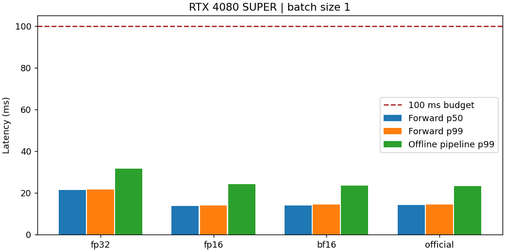

# 08 · RTX 4080 SUPER 추론 벤치마크

## 하드웨어와 측정 방법

2026-11-27, RTX 4080 SUPER 16,376 MiB, 드라이버 `560.35.03`, PyTorch `2.8.0+cu128`, Lightning 2.6.1, Ubuntu 20.04.6, i7-13700에서 실측했다. 시작 시 GPU 217 MiB, 사용률 0%, CUDA compute 프로세스는 없었다. 종료 직전에는 총 1,245 MiB, 벤치마크 Python만 compute 프로세스로 표시됐다. 공식 seed 0 체크포인트의 config 해석·생성·로드·GPU 준비에 **1,913 ms**가 걸렸다. SHA 검사, 다운로드 및 첫 warm-up은 이 로딩 시간에서 제외했다.

공식 로그의 anchor 40 tensor를 GPU에 고정하고 각 모드에서 batch 1, `eval()`, `torch.inference_mode()`로 warm-up 50회 뒤 500회씩 3회 반복했다. 같은 프로세스에서 연속 반복했고, 측정 중 그림과 모델 hook을 사용하지 않았다. CUDA Event와 GPU 동기화가 포함된 wall-clock을 함께 기록했다. 별도로 anchor 40–59의 서로 다른 20개 관측을 각 모드에 순차 입력해 offline 전체 시간을 쟀다. 전체 시간은 Arrow read/JPEG decode, CPU feature의 batch 구성, H2D, 동기화된 forward와 planning의 속도 후처리·호스트 전송을 포함한다. 스토리지 cold-cache, 인지 결과 전체 전송, 컨트롤러는 측정 경계 밖이다. [벤치마크 스크립트](../TFv6/tools/benchmark_baseline.py)

| 모드 | dtype 및 실행 조건 | 결과 |
|---|---|---|
| FP32 eager | Autocast off, TF32 off | PASS |
| FP16 autocast | Autocast FP16, 내부의 명시적인 BF16 입력 cast용 flag 비활성, TF32 off | PASS |
| BF16 autocast | Autocast BF16, TF32 off | PASS |
| Official | 공식 `PolicyRunner.forward`의 BF16 autocast, CARLA agent의 TF32 on · cuDNN benchmark on을 적용 | PASS |
| `torch.compile` | 선택 항목. CUDA 호환성과 분리하여 검증 필요 | NOT TESTED |

모든 모드에서 cuDNN benchmark를 켰다. precision 비교와 별도로 Official 열은 공식 정책의 모델 forward 설정을 적용한 경로다. CARLA agent의 센서 수신·controller·시뮬레이터 영상을 실행하지 않았다. [공식 PolicyRunner](https://github.com/kesai-labs/lead/blob/3764f79698922896638638df8062f2e064034610/src/lead/evaluation/inference/policy_runner.py) · [공식 CARLA 설정](https://github.com/kesai-labs/lead/blob/3764f79698922896638638df8062f2e064034610/src/lead/api/abstract_driving_agent.py)

## 모델 forward와 메모리

| GPU 입력을 재사용한 모델 forward | FP32 | FP16 | BF16 | Official |
|---|---:|---:|---:|---:|
| Wall mean (ms) | 21.381 | 13.731 | 14.062 | 14.112 |
| Wall p50 (ms) | 21.356 | 13.721 | 14.048 | 14.099 |
| Wall p95 (ms) | 21.506 | 13.868 | 14.187 | 14.234 |
| Wall p99 (ms) | 21.593 | 13.976 | 14.321 | 14.361 |
| Wall max (ms) | 22.889 | 14.230 | 14.509 | 14.722 |
| CUDA Event mean / p99 (ms) | 21.362 / 21.571 | 13.714 / 13.958 | 14.046 / 14.304 | 14.095 / 14.345 |
| 1 / mean (회/s) | 46.77 | 72.83 | 71.11 | 70.86 |
| Peak allocated / reserved (MiB) | 8,662.5 / 8,690 | 1,037.6 / 1,148 | 1,038.4 / 1,148 | 1,038.4 / 1,148 |
| 100 ms 초과 (각 1,500회) | 0 | 0 | 0 | 0 |

메모리 peak는 warm-up이 포함된 Torch allocator 실측이다. cuDNN 탐색 및 workspace 영향이 포함될 수 있고, FP32에서 높아진 부분을 개별 연산별로 프로파일링하지 않았다. Official의 세 반복 p99는 약 14.335/14.366/14.333 ms였다.

## 서로 다른 공개 관측 20개에서의 offline 시간

| 단계 평균 (ms) | FP32 | FP16 | BF16 | Official |
|---|---:|---:|---:|---:|
| 읽기·JPEG decode | 4.820 | 4.722 | 4.673 | 4.619 |
| CPU feature·batch | 1.570 | 1.372 | 1.392 | 1.231 |
| CPU→GPU | 1.005 | 0.987 | 1.039 | 0.984 |
| Forward wall | 21.549 | 14.481 | 15.016 | 15.032 |
| Planning 후처리 | 0.147 | 0.164 | 0.164 | 0.168 |
| 전체 mean | 29.090 | 21.726 | 22.283 | 22.034 |
| 전체 p50 | 28.619 | 21.479 | 22.108 | 21.957 |
| 전체 p95 | 30.976 | 23.837 | 23.331 | 22.216 |
| 전체 p99 | 31.628 | 24.056 | 23.361 | 23.315 |
| 전체 max | 31.791 | 24.111 | 23.368 | 23.589 |
| 전체 100 ms 초과 | 0/20 | 0/20 | 0/20 | 0/20 |

## FP32 결과와 수치 비교

동일 anchor 40을 사용했다. 위치 차이는 두 모드 간 같은 인덱스 XY의 Euclidean 거리다. 속도 오차는 후처리 후 m/s의 절댓값이며, 확률 차이는 8개 bin의 최대 절댓값이다. 네 비교 출력에서 유한값을 확인했다.

| 모드 | Route 평균 / 최대 (m) | Waypoint 평균 / 최대 (m) | 속도 차이 (m/s) | bin 확률 차이 최대 |
|---|---:|---:|---:|---:|
| FP16 | 0.000476 / 0.000799 | 0.000949 / 0.002488 | 0.000007 | 0.000002 |
| BF16 | 0.002547 / 0.003299 | 0.003159 / 0.013866 | 0.015245 | 0.003934 |
| Official | 0.002496 / 0.003300 | 0.006719 / 0.021326 | 0.009150 | 0.002346 |

FP16은 이 조건에서 FP32 대비 약 1.56배 빨랐다. 위 값은 같은 관측에서의 정밀도 차이다. 정지 임계값 근처, 조명 변화, 낯선 도로에서의 출력과 실제 제어는 추가 관측이 필요하다.

## 10 Hz 예산과 남은 측정

Official의 독립 모델 p99 **14.361 ms**는 50 ms 이하이며, 100 ms 주기에서 산술적으로 **85.639 ms**가 남는다. 20프레임 offline p99 **23.315 ms**를 기준으로는 **76.685 ms**다. 100 ms 초과가 관찰되지 않았고, 범위가 좁은 offline p99는 장시간 실시간 deadline을 나타내지 않는다. 실제 MORAI 동시 실행에서 GPU 렌더링 경합, RGB 수신·카메라 간 skew, 상태 정렬, IPC/ROS/UDP, MPC, 실제 명령 반영까지 포함한 fresh-plan 도착 시각과 miss rate를 측정해야 한다. [MORAI 연동 요구사항](09_MORAI_INTEGRATION_REQUIREMENTS.md)
