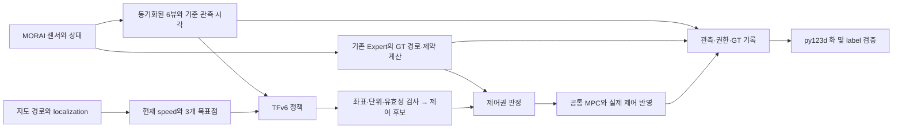

# 09 · Phase 3 MORAI 연동 요구사항

## 모델을 연결하기 전에 대조할 계약

아래는 Phase 2의 모델 실측과 기존 `molit_e2e` 구현을 바탕으로 한 요구사항이다. 새 센서 장착, adapter, controller, writer는 Phase 3에서 검증할 대상이다. [Expert Recovery](../Expert/README.md) · [DAgger](../DAgger/README.md) · [Scenario Randomizer](../Scenario_randomizer/README.md)

| 항목 | 기존 molit_e2e | TFv6 seed 0 계약 | 재사용 판정과 필요한 확인 |
|---|---|---|---|
| Camera | 기존 learner의 전방 RGB+LiDAR | 384×384 RGB 6장, 순서 L1/L0/F0/R0/R1/B0 | 동기화 및 6뷰 rig를 새로 대조. 원본 MORAI pinhole FOV, distortion, 차량 기준점을 실측 |
| Spatial path | anchor에서 유효한 teacher 지역 경로의 25 XY와 mask | teacher route 앞 20개로 smoothing, 10개 고정 공간 정답 | 원래 교사 경로는 후보. 변환·smoothing 후 mask/경계 정책 점검. 25개 라벨의 임의 slice로 동일 의미를 보장할 수 없음 |
| Temporal waypoints | 실제 교사 Ego +0.25…+2.0초 8점 | 같은 시간 간격의 미래 위치 8개 | 시간 계약은 맞는다. 카메라 anchor, pose 기준점·좌표, 유효 교사 권한 전체를 검증한 샘플에 재사용 가능 |
| Prediction horizon | 교사 시간 라벨 2초. path와 MPC는 별도 | 2초 temporal과 약 11.5 m spatial의 두 출력 | 제어용 거리/시간을 독립적으로 검사. 아래 MPC lookahead 확인 |
| Speed label | 별도 Expert MPC worker의 속도 필드, 관측 ID·해시 일치 및 validity. 이전 0은 placeholder | expert policy의 desired m/s와 brake를 two-hot | 같은 단위라도 교사 기준이 다를 수 있다. speed 시점·정지 사유·worker 결과의 의미를 대조, invalid/placeholder는 제외 |
| Coordinate | 지도 MGEO 로컬 UTM, 원본 ENU heading, `base_link` +x 전/+y 좌 | model ego +x 전/+y 우, py123d raw/world ISO | Y와 각도 부호 및 ego 원점 검증. 시각이 같은 pose를 기준으로 변환 |
| Ground truth | 원본 Ego/Object GT, 제약, 경로; run별 센서 지원 다름 | 6뷰 RGB/보조 정답, 지도/신호/객체와 가시성 | 전문 제어/평가 데이터 재사용 후보. 인지용 class/instance/depth 캡처와 지도 raster 계약을 별도 확인 |
| Observation ID | episode/generation/observation ID와 snapshot hash가 선택경로·worker 결과에 연결 | anchor tick과 각 stream의 µs timestamp | 공통 키를 유지해 Arrow sync row에 연결. 시뮬레이터 리셋마다 시간 epoch와 run ID를 분리 |
| Authority | MODEL, pending, RECOVERY/STABILIZE, handback과 실제 MPC·UDP 관측 | 공식 CARLA 원본은 expert 로그. temporal label 전체 구간의 expert authority 필요 | pending·공백·리셋을 마스크. 공간 교사 제안은 그 anchor에서 독립 검증 가능. 미래 복구 시점을 앞 샘플에 소급하지 않음 |
| Dataset format | 기존 원본 로그와 파생 라벨·validity | py123d Arrow IPC + metadata, SceneFilter와 dataset 파생 정답 | raw tick/time·ID 보존, round-trip 스키마 검사. 고정 builder가 지원하는 완전한 학습 샘플 계약 확인 |

관측마다 센서 자체 시각과 수신 시각, 6뷰 skew, 당시 Ego pose·속도, nav 갱신 시각을 함께 연결한다. 완성된 관측의 한 모델 결과가 지연되어 도착하면 새 관측의 결과로 집계하지 않는다. 모델 입력에 필요한 `speed`는 차체 전방의 m/s이며 제어 연결을 위해 실제 steer/yaw rate 또한 별도로 필요하다. 좌·우 90° 회전, 직진, 정지, 알려진 표적을 여러 시야에서 재투영하는 테스트로 extrinsic·heading·distortion을 판정한다. 4 Hz 공식 저장과 10 Hz 이상 운영 목표는 다른 시간 계약이다. [카메라와 좌표 값](03_MODEL_INPUT_OUTPUT.md) · [원본/라벨 수집 표](05_TRAINING_DATA_AND_LABELS.md)

## 공식 제어 경로와 기존 Precision MPC

공식 기본값은 `steer_modality=route`, 가속·브레이크는 `target_speed`다. 추론 속도는 softmax 기대값에서 계산하고, `P(stop)>0.9`이면 0으로 강제한다. `PathSpeedTracker`는 공간 점을 조향 PID에 전달하고 목표 속도 0.01 m/s 미만 또는 실제/목표 속도 비율 1.1 초과를 제동 조건으로 본다. 종방향 `LongitudinalController`는 추가 하한·제동 조건과 회귀 기반 throttle을 적용한다. `WaypointTracker`는 0.5–1.0초 두 waypoint 사이 거리의 두 배를 목표 속도로 사용하고, 0.4 m/s 미만 또는 초과 속도 비율로 제동한다. 속도 기반 lookahead 점의 `atan2(y,x)`로 조향 PID를 갱신하며 매우 저속 또는 제동 시 이 각 입력을 0으로 둔다. agent는 제동과 가속이 같이 설정되면 throttle을 0으로 한다. [공식 후처리와 modality 선택](https://github.com/kesai-labs/lead/blob/3764f79698922896638638df8062f2e064034610/src/lead/evaluation/agents/transfuser/transfuser_agent.py#L71-L183) · [Tracker 구현](https://github.com/kesai-labs/lead/blob/3764f79698922896638638df8062f2e064034610/src/lead/evaluation/inference/trackers.py#L28-L197) · [종방향 제어](https://github.com/kesai-labs/lead/blob/3764f79698922896638638df8062f2e064034610/src/lead/common/pid.py#L175-L244)

기존 `expert-recovery`의 `4700a27`에 있는 `src/control/src/precision_mpc_control.cpp`를 확인했다. 기본 `/selected_path`는 `base_link`의 경로를 받고 timestamp에 따라 경로를 현재 차량 자세로 보정한다. 최소 입력은 4 pose, 기본 path 및 feedback timeout은 0.35초다. 기본 제어 20 Hz, 최대 70 steps(3.5초), 최소 40 steps(2초)이며, 경로 길이와 2 m margin을 고려해 horizon을 조절한다. 조밀하거나 중복된 점은 제거될 수 있다. 이 버전은 XY 곡률과 규칙 제약으로 속도 프로파일을 다시 계산한다. `pose.position.z`에 모델 속도를 넣어도 `/selected_path` reader의 속도 제어 입력이 되지 않는다. 실제 계획에서 선택할 MPC revision과 launch override를 고정하고 단위·제약을 재확인해야 한다. [기존 Expert의 제어 흐름과 원본 추적](../Expert/README.md) · [기존 DAgger의 경로·속도 연결](../DAgger/README.md)

- **Route는 횡방향 제어의 첫 후보**다. 모델 좌표의 `(x,y)`를 동일한 차량 원점일 때 `(x,−y)`로 바꾸고, 실제 원점 간 이동까지 확인한다. 10점의 유한성, 전진 진행, 곡률, 중복, 타임스탬프, 거리 범위를 검사한다. 10 m/s에서 최소 2초 동작만 고려해도 약 20 m가 필요하므로 11.5 m Route가 모든 구간 MPC에 적합하다고 가정할 수 없다. 거리가 부족할 때의 제어/감속 계약과 원점 근방 참조를 검토한다.
- **Waypoint는 시간 궤적과 속도 추정 후보**다. 구간별 `Δs/0.25 s`를 계산할 수 있지만 정체·단거리·중복점을 다뤄야 한다. Route의 공간 좌표 s에 속도를 놓으려면 동일 reference frame에서 거리로 대응시키고 curvature·가감속·정지/정책 제한을 확인한다. Target Speed scalar는 정책이 요청하는 m/s로 별도 후보를 다룬다. 누가 속도/제동을 최종 결정하는지 정하고 brake가 비정상적으로 우회되지 않는지 시험한다.
- **제어권과 지연**은 sensor anchor → model output → 선택 경로 → MPC 결과 → 송신 → 차량 반응까지 같은 ID로 측정한다. 입력 만료 또는 끊긴 센서의 fallback과, Expert takeover/handback의 authority 연속성을 검증한다. 10 Hz 판정에는 서로 다른 fresh 관측에서의 계획 발행 주기, 100 ms 전체 시간의 p95/p99/miss rate와 simulator 경합이 포함된다.

## Expert, 시나리오 및 데이터 저장

기존 Expert Recovery와 v0.5.0 Scenario Generator에서 검증된 경로·GT와 버전·seed를 실험의 초기 조건으로 추적할 수 있다. 로그에 map/rig/정책/시나리오 버전, seed, 신규·원본 구분, 실패 및 종료 사유를 남긴다. 관측 시점에 valid했던 teacher spatial route와 같은 snapshot의 speed/brake를 보존한다. 실제 미래 ego label에는 teacher가 운전한 구간만 채택한다. 공개 LEAD 스키마에 맞춘 writer를 검증할 때 raw 영상과 보정, sync row, teacher authority·ID, 차선·신호·객체 GT를 왕복 확인한다. 인지 head까지 학습할 시 dataset의 class 매핑, 가시성, 거리 스케일 및 동일 카메라 정답 매칭을 별도로 확보한다. [시나리오 실측 기록](../Scenario_randomizer/README.md) · [공식 학습 정답 생성](05_TRAINING_DATA_AND_LABELS.md)
