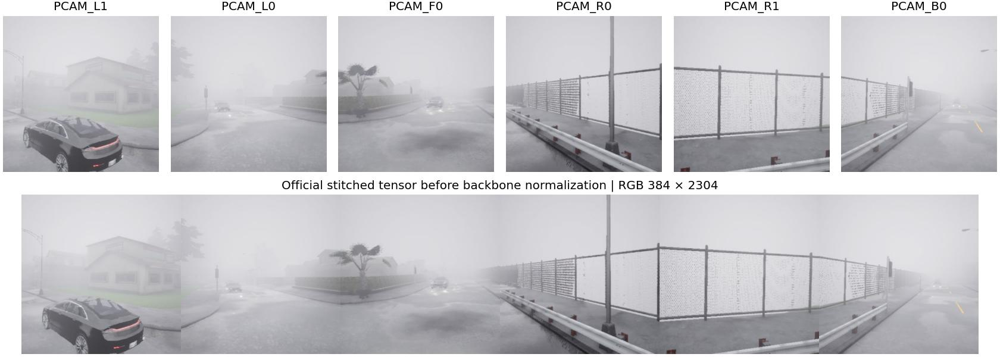
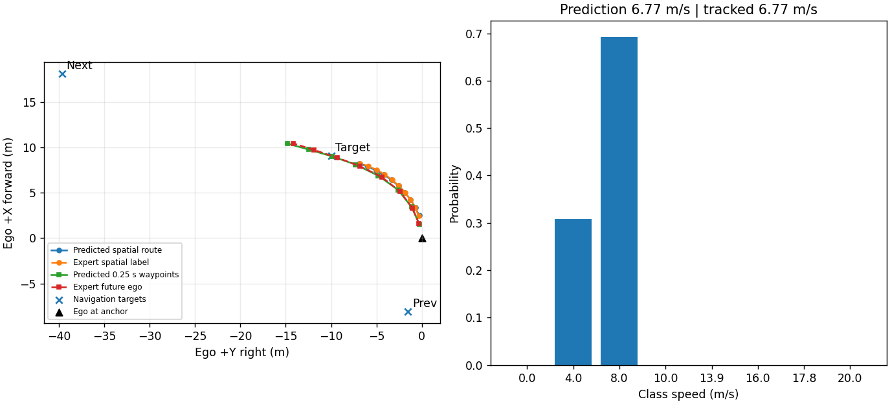
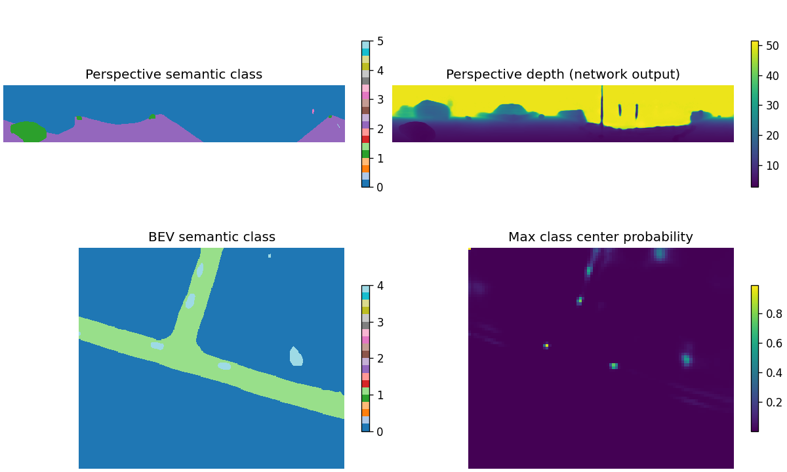

# 10 · 공식 CARLA 관측 한 프레임 따라가기

## 1. 관측 선택과 카메라 디코딩

공개 데이터 `ln2697/lead-123d`의 고정 revision `49565fcf35fd02b03c322a5ab560631b9c706a53`에 있는 Town01 `SignalizedJunctionLeftTurn`, `Town01_Rep0_route_002516_route0_08_02_07_01_23`을 읽었다. Normal-view, RGB가 존재하는 tick과 미래 40 tick이 확보되는 조건으로 61개 scene이 선택됐다. 아래는 0부터 번호를 매긴 **scene index 50**, 원본 tick **251**, 카메라 시각 **12,550,000 µs**다. `sync.arrow`에서 같은 anchor의 6개 RGB와 Ego row를 찾아 `SceneLoader`가 `SceneData`로 조립한다. [공개 로그 출처 및 라이선스](07_INFERENCE_VERIFICATION.md) · [원본 스키마](05_TRAINING_DATA_AND_LABELS.md)

고정 공식 JPEG 디코더는 카메라마다 `(384,384,3)`의 uint8 RGB를 만든다. metadata의 초점거리는 `fx=fy=332.553755 px`, 중심점은 `(192,192) px`, distortion은 None이다. 카메라별 실제 외부 보정은 [센서 계약](03_MODEL_INPUT_OUTPUT.md)에 있다. `build_camera_features`가 L1→L0→F0→R0→R1→B0을 연결하고 CHW로 바꿨다. 아래의 위쪽은 각각 디코딩한 6장이고 아래쪽은 모델이 정규화 직전에 소비한 배열이다. 이 프레임의 픽셀 범위는 26–255였다.

## 2. 현재 Ego와 navigation

py123d의 raw IMU pose는 ISO global 기준 `[x,y,z,qw,qx,qy,qz] = [161.566865, 1.658341, 0.370096, −0.146297, −0.005733, 0.010503, 0.989168]`이다. Ego 속도 벡터를 전방으로 투영한 속도는 **5.936514 m/s**다. 공식 loader는 현 localization과 저장된 target point 인덱스에서 세 목표점을 가져와 모델의 ego XY로 변환했다. 좌회전 구간이므로 전방을 향한 현재와 다음 목표점의 Y가 음수다. 이 목표점은 route에서 골라낸 navigation 조건이고 시간-궤적 정답은 아래에서 별도로 구한다.

| 실제 batch 입력 | 값 또는 shape | dtype, device |
|---|---|---|
| `rgb` | `(1,3,384,2304)` | float32, cuda:0 |
| `speed` | `[5.936514]`, `(1,)` | float32, cuda:0 |
| `previous_target_point` | `[[-8.0910,-1.5585]]`, `(1,2)` m | float32, cuda:0 |
| `target_point` | `[[9.1041,-10.0019]]`, `(1,2)` m | float32, cuda:0 |
| `next_target_point` | `[[18.1164,-39.6630]]`, `(1,2)` m | float32, cuda:0 |
| `town` | `['town01']` | 문자열 목록. 모델 수치 연산에는 사용하지 않음 |

## 3. Backbone과 계획 디코더

RGB float32 tensor는 backbone에서 BF16 cast와 ImageNet 정규화를 거친다. RGB의 첫 ResNet stage는 `(1,64,96,576)`을 출력한다. 학습된 격자의 stage 1은 `(1,64,80,96)`이다. 네 번의 feature fusion 이후 최종 RGB 특징은 `(1,512,12,72)` float32, BEV 특징은 `(1,512,10,12)` BF16이었다. 이 BEV 특징을 120개 공간 토큰으로 투영하고 속도와 세 navigation 토큰을 더한 context는 `(1,124,256)` float32였다. 19개 query에 대한 Transformer Decoder 결과는 `(1,19,256)` float32였다. 열 개 공간 query와 여덟 개 시간 query는 각각 XY 변위로 변환해 누적하고, 나머지 하나는 8개 속도 logits을 만든다. [레이어별 hook과 해설](02_MODEL_ARCHITECTURE.md)

## 4. 계획 예측과 전문가 정답

좌표는 모두 anchor를 원점으로 한 **(전방 X, 우측 Y), m**다. 두 출력의 첫 점 위치가 다른 이유는 공간 Route는 약 2.5 m부터, 시간 Waypoint는 0.25초 뒤부터 샘플하기 때문이다. 아래 숫자는 공식 builder와 BF16 모델의 결과를 반올림했다.

| Route 점 | 예측 (X,Y) | 현재 expert route label (X,Y) |
| ---: | ---: | ---: |
| 1 | (2.5000, -0.3008) | (2.4769, -0.3393) |
| 2 | (3.4062, -0.7305) | (3.3868, -0.7541) |
| 3 | (4.2617, -1.2578) | (4.2528, -1.2542) |
| 4 | (5.0508, -1.8789) | (5.0453, -1.8640) |
| 5 | (5.7734, -2.5781) | (5.7774, -2.5452) |
| 6 | (6.4219, -3.3477) | (6.4408, -3.2935) |
| 7 | (6.9961, -4.1758) | (7.0294, -4.1019) |
| 8 | (7.4844, -5.0547) | (7.5349, -4.9647) |
| 9 | (7.8906, -5.9727) | (7.9283, -5.8841) |
| 10 | (8.2422, -6.9180) | (8.2528, -6.8300) |

| Waypoint 시각 (s) | 예측 (X,Y) | 실제 future expert ego (X,Y) |
| ---: | ---: | ---: |
| +0.25 | (1.5547, -0.2852) | (1.5944, -0.3082) |
| +0.50 | (3.4219, -1.1289) | (3.3206, -1.0405) |
| +0.75 | (5.3359, -2.6289) | (5.1472, -2.4123) |
| +1.00 | (6.8984, -4.8164) | (6.7543, -4.4246) |
| +1.25 | (8.1250, -7.3164) | (7.9458, -6.8394) |
| +1.50 | (9.0312, -9.9102) | (8.8917, -9.3583) |
| +1.75 | (9.7773, -12.4570) | (9.7330, -11.8777) |
| +2.00 | (10.4297, -14.8164) | (10.4581, -14.1605) |

| 속도 bin (m/s) | logit | softmax 확률 |
| ---: | ---: | ---: |
| 0 | -4.18750 | 1.967735e-05 |
| 4 | 5.46875 | 0.3073426 |
| 8 | 6.28125 | 0.6926072 |
| 10 | -3.79688 | 2.908124e-05 |
| 13.888889 | -6.96875 | 1.219228e-06 |
| 16 | -9.81250 | 7.096761e-08 |
| 17.777778 | -11.37500 | 1.487562e-08 |
| 20 | -8.75000 | 2.053516e-07 |

기댓값은 **6.770541 m/s**다. 정지 bin 확률이 0.9 미만이므로 공식 속도 후처리도 같은 값을 반환했다. expert policy의 동시점 목표 속도는 **6.645411 m/s**, brake는 false였으며 two-hot 정답은 4 m/s bin 약 0.339, 8 m/s bin 약 0.661이었다. 실측 현재 속도 5.936514 m/s는 입력이다.

| Scene/tick | 카메라 시각 (µs) | 현재 Ego speed (m/s) | 후처리 목표 speed (m/s) | 마지막 Route XY (m) | 마지막 2초 Waypoint XY (m) |
| --- | ---: | ---: | ---: | ---: | ---: |
| 50 / 251 | 12,550,000 | 5.936514 | 6.770541 | (8.2422, -6.9180) | (10.4297, -14.8164) |
| 51 / 256 | 12,800,000 | 7.149151 | 7.975649 | (8.4766, -6.8086) | (12.0781, -14.7461) |
| 52 / 261 | 13,050,000 | 8.347505 | 8.986995 | (9.2266, -6.0420) | (14.4922, -12.5625) |

연속 프레임에서 전진 속도와 목표 속도가 함께 올라갔다. 좌표가 매 관측의 새 ego 기준이므로 world trajectory로 합치려면 pose 변환이 필요하다. 같은 로그의 앞쪽 scene 40에서는 Official의 마지막 WP가 (12.0391, -0.1535) m이고 목표 속도는 11.0695 m/s였다. 같은 기준에서 좌회전 중인 50의 음의 횡변위가 훨씬 크다.

## 5. 활성 인지 출력과 지도 학습

Perspective 분할 `(1,10,384,2304)`과 Depth `(1,384,2304)`는 BF16이고, BEV 분할 `(1,12,320,384)`은 FP32다. CenterNet heatmap sigmoid 확률 `(1,7,80,96)`은 FP32이며 크기·offset·yaw·velocity 출력은 BF16이다. Route `(1,10,2)`와 WP `(1,8,2)`는 FP32, 속도 logits `(1,8)`은 BF16, 기대 속도 `(1,)`는 FP32였다. 그림의 분할은 각각 argmax, depth는 L1 회귀 출력(m), heatmap은 각 위치에서 최대 클래스 확률을 보여준다.

그 후 동일 index를 `TransfuserDataset`으로 다시 읽어 정답을 별도로 조립하고 eval forward의 예측과 비교했다. Depth·semantic은 각각 원본 6뷰에서, BEV 분할과 boxes는 Town01 map·주변 객체·가시성에서, expert route와 속도는 관측 시점의 `driving_meta`, waypoints는 +5…+40 tick의 Ego 위치에서 얻었다. `compute_loss`가 반환한 값은 아래와 같다. 역전파는 수행하지 않았다.

| 정답과 비교한 값 | 개별 loss (정규화·가중치 적용 전) |
|---|---:|
| Spatial Route 전체와 마지막 점 L1 | 0.085320 |
| 미래 Waypoint XY 평균 L1 | 0.240584 |
| Speed two-hot CE | 0.642443 |
| Perspective semantic CE / depth L1 (m) / BEV semantic CE | 0.012406 / 2.049405 / 0.053473 |
| CenterNet heatmap / wh / offset | 0.181903 / 0.046933 / 0.161153 |
| CenterNet yaw 분류 / yaw 잔차 / velocity | 0.000663 / 0.003597 / 1.859188 |

예를 들어 마지막 waypoint의 Y 차이는 표에서 약 0.656 m다. 그 차이는 이 waypoint의 X 오차와 다른 시간점의 오차와 함께 평균에 들어간다. 속도 CE는 두 bin 확률 자체를 비교하므로 단일 속도 차이 `0.125 m/s`와 수치가 다르다. Velocity loss는 값이 계산되나 공식 LTF 가중치가 0이다. 그림과 수치는 공개된 한 관측의 실행 결과다. [Loss의 환산과 가중치](06_TRAINING_AND_LOSS.md) · [실행 재현](07_INFERENCE_VERIFICATION.md)
